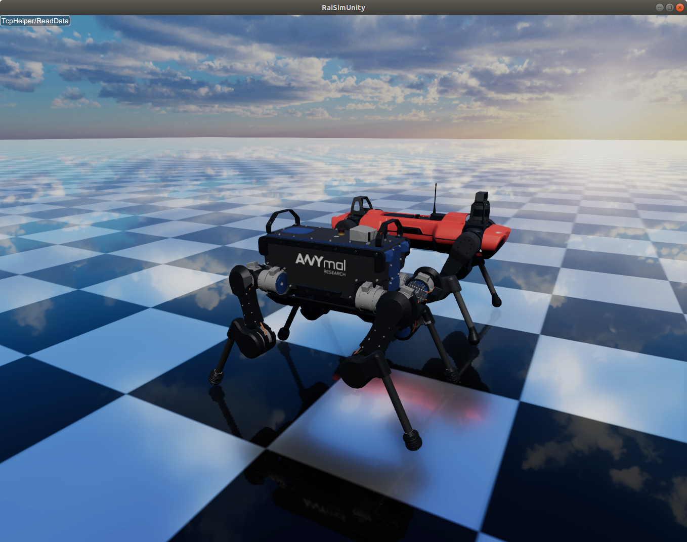
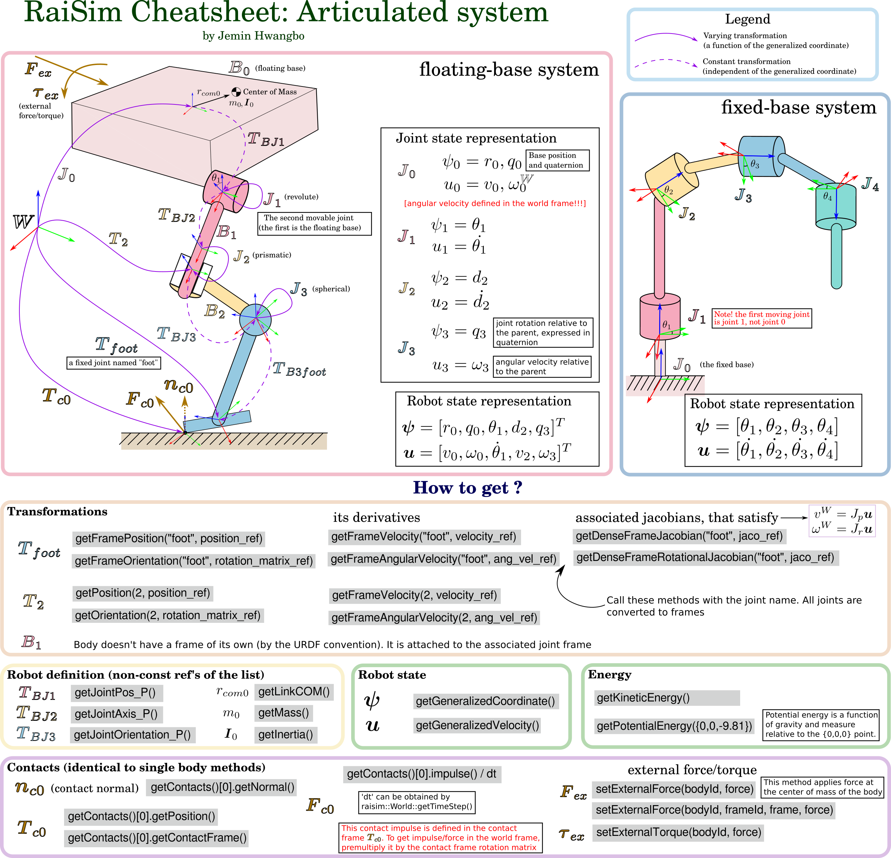

# Articulated Systems

ANYmal robots (B and C versions) simulated in RaiSim.

An articulated system comprises multiple bodies interconnected via joints.
There are two kinds of articulated systems: kinematic trees and closed-loop systems.
A kinematic tree has no loops, so each body has exactly one parent joint.
Consequently, the number of joints in a kinematic tree equals the number of bodies; the root body of a floating-base system is attached to the world by a floating joint.

A closed-loop system has one or more loops, i.e., there are multiple paths from a body to the root.
RaiSim's algorithmic backbone, the Articulated Body Algorithm, cannot solve the dynamics of a closed-loop system directly.
Instead, RaiSim simulates a spanning tree of the system and closes the loops with pin or equality constraints, which it eliminates exactly before the contact solve.
These pages focus on kinematic trees.
Closed-loop systems are described in [Closed-Loop Systems](./articulated_system/ClosedLoopSystems.md).

In kinematic trees, **since each body has only one parent joint, the index of a body always matches that of its parent joint**.
Here, a "body" denotes a rigid body composed of one or more "links" that are rigidly connected to each other via fixed joints.

- [Creating an Articulated System](./articulated_system/Creation.md)
- [State and Kinematics](./articulated_system/StateAndKinematics.md)
- [Dynamics and Control](./articulated_system/DynamicsAndControl.md)
- [Joint Damping and Friction](./articulated_system/JointDampingAndFriction.md)
- [Actuators](./Actuators.md)
- [Sensors](./Sensors.md)
- [Modifying the Model in Code](./articulated_system/ModifyingTheModel.md)
- [Closed-Loop Systems](./articulated_system/ClosedLoopSystems.md)
- [Mimic Joints](./articulated_system/MimicJoints.md)
- [Tracks](./articulated_system/Tracks.md)
- [ArticulatedSystem API](./articulated_system/API.md)

**TL;DR**

A vector-graphics version is available as [articulatedSystem.pdf](https://github.com/raisimTech/raisim2Lib/blob/main/rsc/docs/image/articulatedSystem.pdf).
