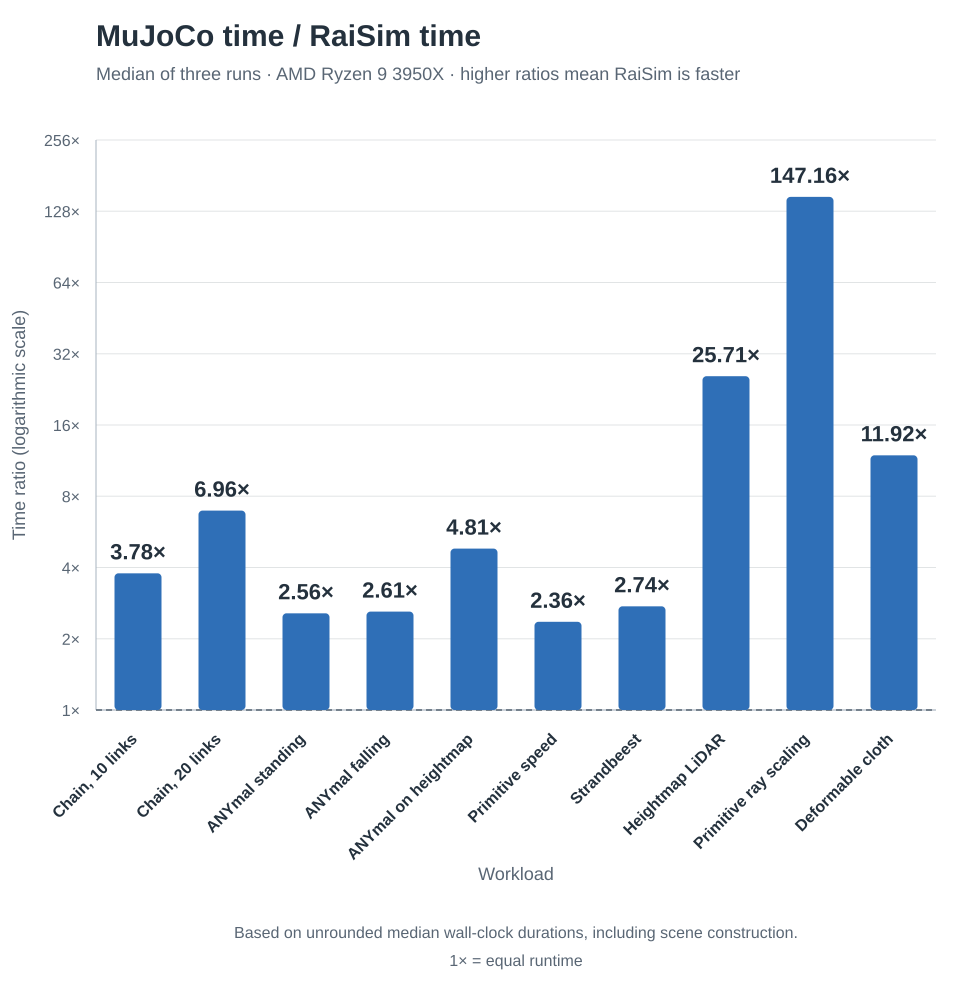
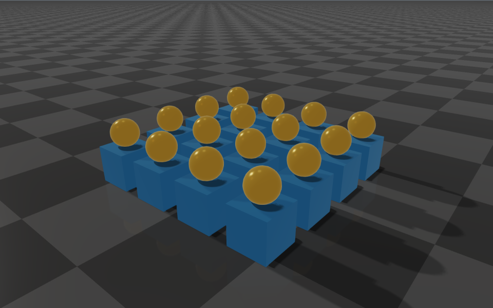
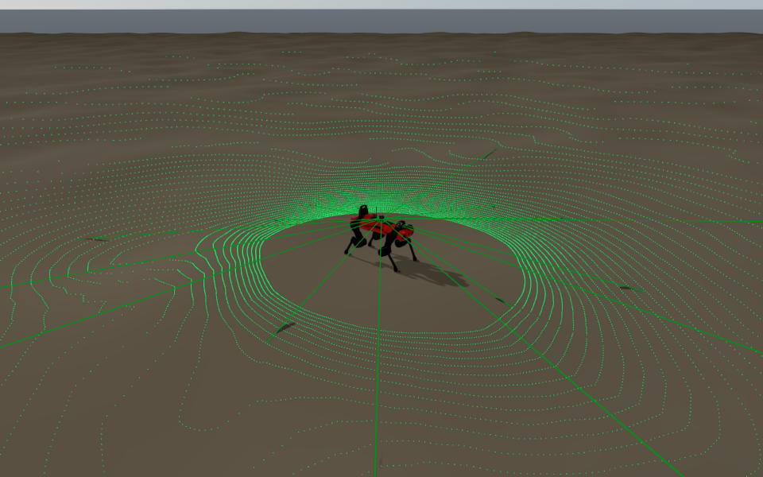
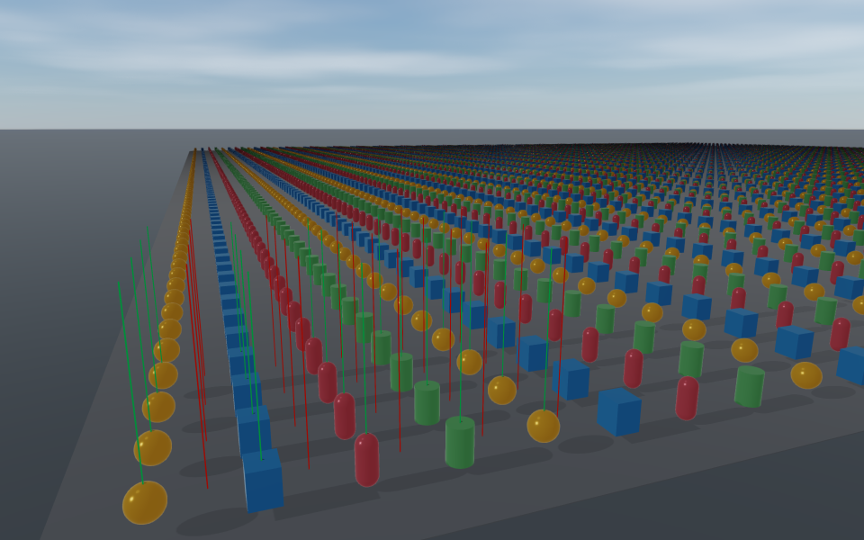
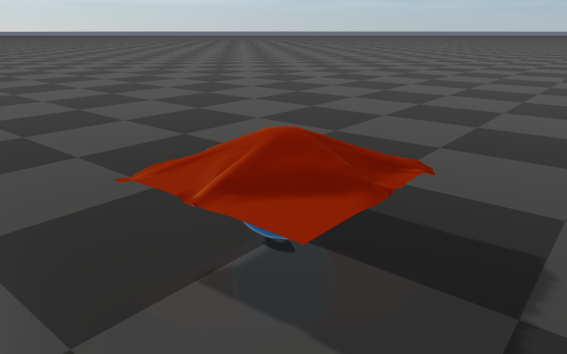
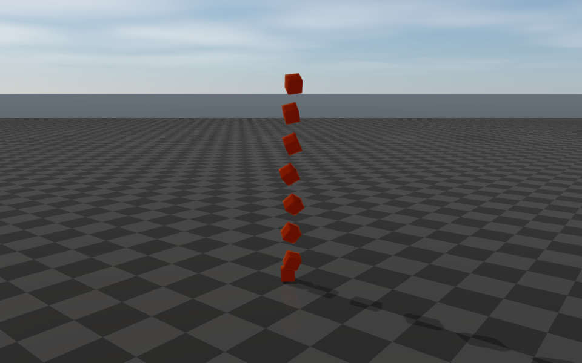

# Benchmark

Eleven workloads cover articulated dynamics, rigid contacts, closed loops, ray queries, and
deformable objects. The tables compare RaiSim and MuJoCo on the same machine, with three runs per
backend. For tuning guidance, see [Performance](./Performance.md).

## Results

**Median wall-clock seconds; lower is better.** The smaller range below each median is
the minimum–maximum of three runs. Speedup is MuJoCo's median divided by RaiSim's median.
All rows run on a single thread and include scene construction and the benchmark loop; rendering is disabled.

<!--@include: ./_benchmark_results.md-->

The eight-cube MuJoCo run reports numerical instability at 0.020 s. Its timing and speedup
are omitted. Cloth and cube-stack backends use different deformable models; their
parameters and comparison limits are in **Workloads**.

<figure>

</figure>

[Download the recorded results and exact arguments](/benchmark_results.json).
Absolute timings depend on the machine, compiler, and scene. These ratios describe the
recorded development build; use your application workload to evaluate the distributed
{{ $raisimVersion }} package.

## Workloads

DOF counts generalized velocity coordinates; a floating base contributes six.
A step count denotes simulation steps unless the row says queries or sensor updates.

<table>
<thead>
<tr>
<th>Benchmark ID</th>
<th>Run</th>
<th>Scene and settings</th>
</tr>
</thead>
<tbody>
<tr>
<td><code>chain10_speed</code></td>
<td><p>100,000 steps</p><p>Δt = 1 ms</p></td>
<td>Fixed-base chain, 10 spherical joints, <strong>30 DOF</strong>. Spring-dampers bend each link by 90°. No collision geometry or contacts; pure articulated dynamics.</td>
</tr>
<tr>
<td><code>chain20_speed</code></td>
<td><p>100,000 steps</p><p>Δt = 1 ms</p></td>
<td>The same spring chain with 20 spherical joints and <strong>60 DOF</strong>.</td>
</tr>
<tr>
<td><code>anymal_standing</code></td>
<td><p>1,000,000 steps</p><p>Δt = 2 ms</p></td>
<td>ANYmal: floating base and 12 revolute joints, <strong>18 DOF</strong>. PD control holds a stance on a plane, with about four persistent foot contacts. Primitive robot collision shapes; friction 0.8.</td>
</tr>
<tr>
<td><code>anymal_falling</code></td>
<td><p>100,000 steps</p><p>Δt = 2 ms</p></td>
<td>ANYmal, <strong>18 DOF</strong>, falling freely with no ground or contacts.</td>
</tr>
<tr>
<td><code>heightmap_anymal_speed</code></td>
<td><p>200,000 steps</p><p>Δt = 2 ms</p></td>
<td>ANYmal, <strong>18 DOF</strong>, on a 20 × 20 m fractal heightmap: 100 × 100 samples, three octaves. Tests robot–terrain contacts.</td>
</tr>
<tr>
<td><code>primitive_speed</code></td>
<td><p>100,000 steps</p><p>Δt = 2 ms</p></td>
<td><strong>32 rigid bodies</strong>: sixteen 0.4 m boxes and sixteen spheres of radius 0.15 m, in a 4 × 4 grid at 0.6 m spacing. Spheres fall onto boxes above a ground plane; tests box–ground and sphere–box contacts.</td>
</tr>
<tr>
<td><code>strandbeest</code></td>
<td><p>3,000 steps</p><p>Δt = 1 ms</p></td>
<td>Twelve-legged linkage, <strong>79 DOF</strong> and <strong>42 hinge closures / 84 pin constraints</strong>, driven by a crank at one revolution per second. RaiSim imports OpenUSD; MuJoCo loads converted MJCF with connect equalities. This row includes import, unlike the simulation-only timing in earlier versions of this page.</td>
</tr>
<tr>
<td><code>heightmap_lidar</code></td>
<td><p>2,000 updates</p><p>Δt = 5 ms</p></td>
<td>Spinning LiDAR on ANYmal C over a <strong>200 × 200 m heightmap, 400 × 400 samples</strong>. Uses 512 yaw × 64 pitch samples per revolution at 10 Hz, ±16.6° pitch and 0.8–40 m range. The robot settles for 200 steps, then stays fixed while sensor time advances. Both backends check hit ratio and terrain-surface error.</td>
</tr>
<tr>
<td><code>primitive_ray_scaling</code></td>
<td><p>10,000 queries</p><p>256 warmup rays</p></td>
<td><strong>10,000 static primitives</strong> on a 2.5 m grid: spheres, boxes, capsules, and cylinders. The deterministic <code>mixed</code> workload casts vertical rays in an incoherent order, with 50% hits. Initial queries verify hits and target IDs; the timed loop consumes hit results. This row is one point in the scaling workload; change <code>--objects</code> and <code>--workload</code> to measure others.</td>
</tr>
<tr>
<td><code>deformable_cloth</code></td>
<td><p>2,000 steps</p><p>Δt = 1 ms</p></td>
<td>Unpinned <strong>32 × 32 cloth grid: 1,024 particles, 1,922 triangles</strong>, 0.035 m spacing, dropped from 0.85 m onto a static sphere of radius 0.25 m and a plane. Six solver iterations. RaiSim uses XPBD distance compliance 10⁻⁵ with bending disabled; MuJoCo uses a 2D flex grid with edge equalities.</td>
</tr>
<tr>
<td><code>deformable_cube_stack</code></td>
<td><p>1,200 steps</p><p>Δt = 1 ms</p></td>
<td><strong>Eight 0.3 m cubes</strong>, stacked above a plane; six solver iterations. Explicit arguments request resolution 4 and collision radius 0.04 m; the shared spacing guard increases resolution to 5. RaiSim uses 784 surface particles with internal struts, compliance 7.5 × 10⁻⁵ and effective collision radius 0.06525 m. MuJoCo uses 1,000 volumetric flex particles, Young's modulus 50 kPa and radius 0.005 m; that run becomes unstable.</td>
</tr>
</tbody>
</table>

Deformable rows compare these implementations and settings, without matching material
response or solver accuracy. In particular, the cube stack uses different particle
counts, masses, and collision radii. A timing ratio alone does not measure physical fidelity.

## Method

| Setting | Recorded configuration |
| --- | --- |
| Machine | AMD Ryzen 9 3950X, 16 cores / 32 threads, 64 GB RAM; x86-64. |
| System | Ubuntu 26.04.1 LTS, Linux 7.0.0-38-generic. |
| Run | October 14, 2026; private development revision `ded44a528` with local rendering fixes. Physics and benchmark sources match that revision. |
| Builds | Clang 20.1.8, C++20, `Release`. RaiSim: `-O3 -DNDEBUG -march=native -mtune=native`; MuJoCo 3.13.0 built from source with `-O3 -DNDEBUG -mavx`. |
| Threading | One thread, pinned to CPU 8 with `taskset`; `OMP_NUM_THREADS`, `OPENBLAS_NUM_THREADS`, `MKL_NUM_THREADS`, and `VECLIB_MAXIMUM_THREADS` all set to 1. Benchmarks run serially, without rendering. |
| Measurement | Three calls per workload and backend. Median, minimum, and maximum of the launcher's wall-clock duration, including construction, warmup, validation, and the benchmark loop. Separate query-only timings appear in the downloadable results for `primitive_ray_scaling`. Speedups use unrounded medians. |
| Arguments | Default launcher arguments for ten workloads; explicit eight-cube arguments below replace the launcher's one-cube, 20-step quick check. Exact arguments for every row are in the downloadable JSON. |

**Private comparison suite.** The launcher and MuJoCo backend are maintained in the
engine repository and are not targets in `raisim2Lib`. The recorded commands are:

```bash
export OMP_NUM_THREADS=1 OPENBLAS_NUM_THREADS=1 MKL_NUM_THREADS=1 VECLIB_MAXIMUM_THREADS=1
taskset -c 8 ./build-benchmark/benchmark/benchmarks --backend=both --repeat 3 \
    -b chain10_speed -b chain20_speed -b anymal_standing -b anymal_falling \
    -b heightmap_anymal_speed -b primitive_speed -b strandbeest \
    -b heightmap_lidar -b primitive_ray_scaling -b deformable_cloth \
    --report --report-dir /tmp/raisim-benchmark-report
taskset -c 8 ./build-benchmark/benchmark/benchmarks --backend=both --repeat 3 \
    -b deformable_cube_stack --report --report-dir /tmp/raisim-cube-stack-report \
    -- --cubes=8 --resolution=4 --steps=1200 --iterations=6 --collision-radius=0.04
```

**Measure the distributed package.** Build the public timing examples from
`raisim2Lib` and repeat your chosen run at least three times:

```bash
cmake -S . -B build-examples -DCMAKE_BUILD_TYPE=Release -DRAISIM_EXAMPLE=ON
cmake --build build-examples --target anymal_standing_benchmark \
    articulated_system_benchmark --parallel 12
OMP_NUM_THREADS=1 OPENBLAS_NUM_THREADS=1 MKL_NUM_THREADS=1 \
    ./build-examples/examples/anymal_standing_benchmark --steps=1000000
```

On Windows, build with `--config Release` and run
`build-examples\bin\anymal_standing_benchmark.exe`. These public examples time RaiSim
only, using their own scenes; they do not reproduce the private comparisons. Keep the
package version, scene, timestep, step count, and machine fixed. See [Build, Test, and Benchmark](./BuildAndTest.md)
for other timing examples.

## Dense-mesh contact workloads

Two additional source benchmarks exercise the Unitree G1's hand collision mesh:
a closed half-sphere with 3,002 vertices and 6,000 triangles. They are separate
from the eleven recorded comparisons above and require the engine source
benchmark runner, which is not shipped in the public binary-package workspace.

| Benchmark ID | Workload and measurements |
| --- | --- |
| `mesh_primitive_proximity` | The hand mesh is posed around a torso cylinder, pelvis box, limb cylinder, capsule and sphere at deterministic random orientations. Many poses overlap in their world AABBs while remaining separated. Defaults: 512 poses per primitive, 20 timed rounds. Reports mean narrowphase time, per-call median, 99th percentile and maximum, overlapping/contact pose counts, and RaiSim contact signatures. |
| `g1_hand_self_collision` | A fixed-base, 29-DoF G1 follows joint PD targets that swing its hands past the torso, pelvis and hips, with intermittent self-contact. Defaults: 20,000 steps at 2.5 ms. Reports mean, 99th percentile and maximum integration time, steps with self-contacts and hand contacts, total contacts, and a RaiSim contact/final-state signature. |

Run from an engine source checkout after building the benchmark runner:

```bash
OMP_NUM_THREADS=1 OPENBLAS_NUM_THREADS=1 MKL_NUM_THREADS=1 \
  ./build-benchmark/benchmark/benchmarks \
  --bench mesh_primitive_proximity --backend=both -- --poses 512 --rounds 20
OMP_NUM_THREADS=1 OPENBLAS_NUM_THREADS=1 MKL_NUM_THREADS=1 \
  ./build-benchmark/benchmark/benchmarks \
  --bench g1_hand_self_collision --backend=both -- --steps 20000
```

For proximity, `--shape torso|pelvis|limb|capsule|sphere` selects one
primitive. MuJoCo collides the hand as a convex hull; RaiSim tests its mesh
triangles. Both use true cylinders. Both G1 runs exclude contacts with the
nearest ancestor that has collision geometry, but use their engines' own
dynamics and contact solvers.
Compare contact counts and, when RaiSim output is expected to match, signatures
alongside timings. A timing ratio alone does not establish matching contact
behavior.

## Scene illustrations

<table>
<tbody>
<tr>
<td>

**Chain, 10 links**


</td>
<td>

**Chain, 20 links**


</td>
</tr>
<tr>
<td>

**ANYmal standing**


</td>
<td>

**ANYmal falling**


</td>
</tr>
<tr>
<td>

**ANYmal on terrain**


</td>
<td>

**Rigid primitives**



</td>
</tr>
<tr>
<td>

**Strandbeest**


</td>
<td>

**Heightmap LiDAR**



</td>
</tr>
<tr>
<td>

**Primitive ray scaling**



</td>
<td>

**Deformable cloth**



</td>
</tr>
<tr>
<td>

**Deformable cube stack**



</td>
<td></td>
</tr>
</tbody>
</table>

Images show the RaiSim setups. The chain, falling robot, and primitive ray field have a floor
only for visual reference. Green LiDAR points are recorded terrain hits; colored ray segments
illustrate hits and misses without changing the benchmark's collision geometry.
