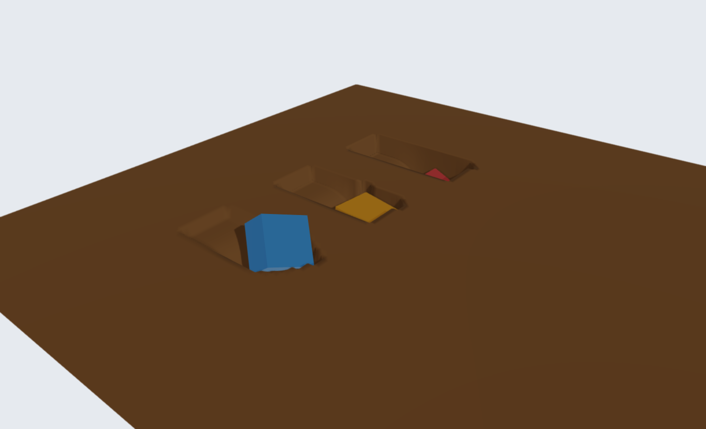

Deformable terrain
==================

``World::addDeformableTerrain`` creates a triangulated, deformable soil bed.
It has no particles: the regular surface mesh stores total sinkage, permanent
sinkage, and accumulated shear displacement at its vertices. Rigid bodies and
articulated systems interact with the bed through distributed pressure and
shear forces. Ray tests and Rayrai use the deformed mesh.

   The example's 10 kg blue, 20 kg orange and 30 kg red blocks after settling
   and one second of dragging. Rayrai renders the simulated mesh heights.

.. figure:: ../../rsc/docs/image/rayrai/deformable_terrain_ruts.png
   :width: 100%
   :alt: Permanent mesh ruts after lifting the three blocks away and allowing elastic recovery.

   The same bed after lifting the blocks away and advancing one simulation
   step. Elastic displacement recovers and permanent ruts remain; mesh heights
   are shown without vertical exaggeration.

Creating a bed
--------------

.. code-block:: cpp

   raisim::DeformableTerrain::Material soil;
   soil.bekkerKc = 0.0;
   soil.bekkerKphi = 4.0e4;
   soil.sinkageExponent = 1.1;
   soil.elasticStiffness = 2.0e6;
   soil.damping = 2000.0;
   soil.cohesion = 100.0;
   soil.frictionCoefficient = 0.6;
   soil.shearDisplacement = 0.01;

   const size_t nx = 201, ny = 101;
   auto* bed = world.addDeformableTerrain(
       nx, ny, 8.0, 4.0, 0.0, 0.0, std::vector<double>(nx * ny, 0.0), soil);
   bed->setName("soil");

Heights use ``height[y * nx + x]``. The mesh covers the same local coordinate
range and has the same triangle diagonals as :doc:`HeightMap`. You may place
the bed with ``setPosition`` and ``setOrientation`` between steps. Deformation
and normal pressure act along the bed's local Z axis. The bed is static;
dynamic and kinematic body types are rejected.

The default values are illustrative parameters, not a calibrated material.
Choose the mesh spacing to resolve the footprint and the desired rut width;
2--5 cm is a useful starting point for robot feet and wheels of comparable size.
Small flat feet are clipped before quadrature, so their contact area remains
resolved even when the footprint fits inside a single cell. Curved footprints,
rut boundaries, and overlapping shapes still require spatial refinement.

Constitutive model
------------------

For total downward displacement :math:`s`, permanent displacement :math:`s_p`,
and projected contact width :math:`b`, the normal pressure is

.. math::

   p(s,s_p,b) = \max\left(0,\min\left[
      K_e(s-s_p),\left(k_c/b+k_\phi\right)s^n\right]\right).

The width is the shorter side of a collider's projected bounding rectangle in
the bed frame. This is a footprint approximation for general shapes; calibrate
the width-dependent term for the intended wheel or foot geometry. Loading
adds viscosity :math:`D\max(\dot{s},0)`. Plastic return keeps
:math:`s_p = \max(s_p,s-p/K_e)`. Unloaded vertices recover elastic displacement
and retain their permanent ruts. Impact loading can therefore produce deeper
ruts than slow loading at the same final weight. Plastic strain increments
are projected onto lumped vertex control areas; the projection preserves
existing history below yield and bounds new vertex values by the sampled
plastic return to avoid artificial ratcheting.

Shear strength follows Mohr--Coulomb and Janosi--Hanamoto:

.. math::

   \tau_{\max} = (c+\mu p_n)(1-\exp[-j/K_j]).

Here :math:`j` accumulates solved tangential slip while the surface is loaded.
The friction impulse opposes motion and stays within this circular strength
bound. ``shearDisplacement = 0`` selects fully mobilized Coulomb friction.
Normal pressure and tangential slip are solved implicitly with the other
world contacts. The contact solver's usual iteration limit and tolerance apply. Here
:math:`p_n` includes loading viscosity, while :math:`p` in the normal law
above denotes its non-viscous elastic/plastic part.

Material parameters
-------------------

``DeformableTerrain::Material`` defines the soil response for the entire bed.
These parameters use SI units: metres, seconds, and pascals (N/m\ :sup:`2`).
They describe pressure and shear stress per unit area; the solver integrates
those stresses over the sampled footprint to obtain forces. Their values do
not need rescaling when changing the mesh spacing or timestep. Refinement
still matters for resolving the geometry and the evolving soil history.

.. list-table:: Defaults and valid values
   :header-rows: 1
   :widths: 30 22 16 32

   * - C++ member
     - Units
     - Default
     - Valid values
   * - ``bekkerKc``
     - :math:`\mathrm{Pa}\,\mathrm{m}^{1-n}`
     - ``0.0``
     - Finite, nonnegative
   * - ``bekkerKphi``
     - :math:`\mathrm{Pa}/\mathrm{m}^{n}`
     - ``2.0e5``
     - Finite, nonnegative
   * - ``sinkageExponent``
     - Dimensionless
     - ``1.1``
     - Finite, strictly positive
   * - ``elasticStiffness``
     - Pa/m
     - ``2.0e6``
     - Finite, strictly positive
   * - ``damping``
     - Pa s/m
     - ``1000.0``
     - Finite, nonnegative; zero disables viscosity
   * - ``cohesion``
     - Pa
     - ``0.0``
     - Finite, nonnegative
   * - ``frictionCoefficient``
     - Dimensionless
     - ``0.6``
     - Finite, nonnegative
   * - ``shearDisplacement``
     - m
     - ``0.01``
     - Finite, nonnegative; zero gives full mobilization

At least one of ``bekkerKc`` and ``bekkerKphi`` must be positive. Invalid
materials throw ``std::invalid_argument`` at construction. The API imposes no
upper bound on finite coefficients; acceptance does not establish that a
value represents a particular soil. The defaults and the softer example bed
above are illustrative rather than measured material presets.

Normal loading: ``bekkerKc``, ``bekkerKphi`` and ``sinkageExponent``
~~~~~~~~~~~~~~~~~~~~~~~~~~~~~~~~~~~~~~~~~~~~~~~~~~~~~~~~~~~~~~~~~~~~

The Bekker loading envelope is :math:`p_y=(k_c/b+k_\phi)s^n`.
Increasing either coefficient at a fixed exponent and footprint raises the
pressure at a given sinkage and reduces the equilibrium sinkage under the
same load, provided the elastic branch is not the limiting response.
``bekkerKc`` supplies the width dependence: its contribution increases as
:math:`b` decreases. ``bekkerKphi`` supplies the width-independent contribution.
Setting ``bekkerKc = 0`` removes this explicit width dependence, although the
footprint's area still affects force and its shape still affects quadrature.
Despite its name, ``bekkerKc`` is a normal pressure coefficient; it is distinct
from the tangential ``cohesion`` parameter.

For a flat plate with uniform pressure :math:`p_{\mathrm{load}}=mg/A` resting
on the yielding envelope, a useful analytical check is

.. math::

   s_{\mathrm{eq}} = \left(\frac{mg}{A(k_c/b+k_\phi)}\right)^{1/n}.

For example, a 20 kg, 0.4 by 0.6 m plate has :math:`A=0.24` m\ :sup:`2`,
:math:`b=0.4` m, and :math:`p_{\mathrm{load}}=817.5` Pa at
:math:`g=9.81` m/s\ :sup:`2`. With :math:`k_c=0`, :math:`k_\phi=10^5`, and
:math:`n=1`, the yielding-envelope sinkage is 8.175 mm. This is a quasistatic
reference for a uniform plate, not a prediction of transient impact depth or
of loading into an existing uneven rut. The elastic branch and accumulated
plastic state can determine the response instead.

``sinkageExponent`` controls the curvature of the loading envelope. Its
incremental stiffness is :math:`n(k_c/b+k_\phi)s^{n-1}`. With :math:`n=1`,
pressure is linear in sinkage. With :math:`n>1`, the incremental stiffness
increases with sinkage; with :math:`0<n<1`, it decreases. Changing :math:`n`
also changes the units of both Bekker coefficients. Comparing materials by
changing only :math:`n` while retaining the same numerical coefficients is
therefore misleading. To hold a reference pressure fixed with :math:`k_c=0`,
choose :math:`k_\phi=p_{\mathrm{ref}}/s_{\mathrm{ref}}^n` for each exponent.

Elastic recovery: ``elasticStiffness``
~~~~~~~~~~~~~~~~~~~~~~~~~~~~~~~~~~~~~~

``elasticStiffness`` is the pressure slope during elastic unloading and
reloading: :math:`p_e=K_e(s-s_p)`. It is a foundation stiffness per area,
not a Young's modulus in Pa or a spring constant in N/m. A uniform area
:math:`A` has elastic force stiffness :math:`A K_e` in N/m. At pressure
:math:`p`, the recoverable displacement on this branch is :math:`p/K_e`.

For example, 1000 Pa with :math:`K_e=2\times10^6` Pa/m gives 0.5 mm of
recoverable sinkage. Increasing :math:`K_e` reduces this recovery and steepens
the unloading/reloading slope. It does not raise the Bekker yield envelope:
normal pressure remains the smaller of the elastic and yielding pressures.
At a fixed peak sinkage on the envelope, a larger :math:`K_e` leaves a larger
permanent fraction through :math:`s_p=s-p_y/K_e`. If the elastic stiffness is
too low relative to the desired loading envelope, the response can remain
mostly elastic and produce much less permanent rutting. Fit this parameter
from unloading/reloading data rather than treating it as a general hardness
control. Completely unloaded vertices recover to their permanent depth on
that step; there is no independent delayed relaxation model.

Loading rate: ``damping``
~~~~~~~~~~~~~~~~~~~~~~~~~

``damping`` adds pressure :math:`p_v=D\max(\dot{s},0)` during penetration.
For example, :math:`D=2000` Pa s/m and a solved loading speed of 0.1 m/s add
200 Pa. Increasing it raises transient resistance and dissipation during
loading; it does not alter the equilibrium pressure when the loading speed
is zero. It supplies no viscous suction or tensile force during unloading.
Zero removes this term while retaining the implicit elastic/plastic solve.

The speed is the displacement rate solved by the coupled contact system,
not the body's unconstrained trial velocity. The total solved normal pressure
:math:`p_n=p+p_v` also enters the frictional strength, so increasing damping
can raise transient shear resistance as well as normal resistance. Calibrate
rate effects separately from the Bekker envelope and check the intended
impact speeds and timestep. This local viscosity does not represent soil
mass, wave propagation, or a volumetric viscoelastic continuum.

Shear strength: ``cohesion`` and ``frictionCoefficient``
~~~~~~~~~~~~~~~~~~~~~~~~~~~~~~~~~~~~~~~~~~~~~~~~~~~~~~~~

The fully mobilized shear stress is :math:`\tau_f=c+\mu p_n`.
``cohesion`` sets its pressure-independent intercept. For example,
:math:`c=100` Pa contributes 10 N over a loaded 0.1 m\ :sup:`2` patch when
fully mobilized. ``frictionCoefficient`` sets the pressure-dependent slope;
:math:`\mu=\tan\phi` if expressing it as a friction angle :math:`\phi`.
At :math:`p_n=1000` Pa, :math:`c=100` Pa and :math:`\mu=0.6`, the fully
mobilized stress is 700 Pa. The displacement law below can reduce the
available stress before mobilization.

Increasing either parameter raises available traction at the same normal
pressure and shear history. With ``frictionCoefficient = 0``, nonzero
``cohesion`` can still resist slip while contact is loaded. Setting both to
zero removes tangential resistance. Cohesion does not bond a body to the
surface or create a tensile normal force when it lifts away.

These soil parameters govern the distributed terrain contact law. The rigid
material-pair friction and restitution settings in :doc:`MaterialSystem` do
not tune this constitutive response. Use the soil's ``Material`` for its
traction and loading response, and material pairs for ordinary rigid contacts.

Traction buildup: ``shearDisplacement``
~~~~~~~~~~~~~~~~~~~~~~~~~~~~~~~~~~~~~~~

``shearDisplacement`` is the Janosi--Hanamoto displacement scale :math:`K_j`:

.. math::

   \frac{\tau_{\max}}{c+\mu p_n}=1-\exp(-j/K_j).

For positive :math:`K_j`, the strength reaches approximately 63.2% at
:math:`j=K_j`, 95% at :math:`j=3K_j`, and 99% at :math:`j=4.605K_j`.
With the default 0.01 m scale, those displacements are 10, 30, and 46.05 mm.
A smaller scale builds traction over less slip; a larger scale produces
slower buildup and more creep before reaching the same strength. Setting
zero selects fully mobilized friction immediately, including any cohesion.

The history is accumulated solved slip displacement at the terrain vertices,
not elapsed time, commanded wheel travel, or body displacement in free flight.
It grows while a patch is loaded and resets when that patch unloads. Permanent
sinkage survives unloading separately. A new footprint therefore does not
inherit the shear history of an unloaded rut. Do not set :math:`K_j` equal to
the cell size to stabilize the solver: fit a physical displacement scale and
refine the spatial discretization as needed.

.. figure:: ../../rsc/docs/image/rayrai/deformable_terrain_material_response.png
   :width: 100%
   :alt: Loading envelopes with a shared reference pressure, elastic recovery, and shear mobilization curves.

   Constitutive curves evaluated from the implemented equations. The loading
   curves share 1000 Pa at 20 mm; the recovery example unloads with
   :math:`K_e=2\times10^6` Pa/m. The shear plot shows different displacement
   scales and the fully mobilized zero-scale case. These are illustrative
   responses rather than measured soil data.

Calibrating a material
~~~~~~~~~~~~~~~~~~~~~~

1. Measure slow plate-loading curves at several widths and loads. Fit
   :math:`n` and the two Bekker coefficients together. At a fixed :math:`n`,
   plotting :math:`p/s^n` against :math:`1/b` gives slope :math:`k_c` and
   intercept :math:`k_\phi`. A single width identifies only their sum
   :math:`k_c/b+k_\phi`; it cannot identify both coefficients separately.
   Use the same projected-width convention as the colliders being simulated.
2. Measure unloading/reloading slopes to fit :math:`K_e`, including recovered
   depth and the remaining rut. Fit the loading envelope and elastic branch
   consistently; the implemented pressure is their minimum.
3. Repeat indentation at different speeds to fit :math:`D` from the extra
   loading pressure, after accounting for quasistatic pressure. Recheck impact
   compaction rather than fitting only the final resting depth.
4. Measure shear stress versus displacement at several normal pressures.
   Fit :math:`c` and :math:`\mu` to the fully mobilized stresses, then fit
   :math:`K_j` to the buildup curves. Include low-speed slip if creep matters.
5. Validate with the intended feet or wheels, loads, speeds, mesh spacing and
   timestep, including unloading and repeated passes. Compare sinkage,
   recovered depth, force and traction histories as well as final poses.
   Agreement with an analytical plate case alone does not establish accuracy
   for a particular soil or for phenomena outside the supported model.

State, rendering and saving
---------------------------

``getSoilState()`` returns three arrays with one value per vertex:
``sinkage``, ``plasticSinkage``, and ``shear``. ``setSoilState`` validates and
restores these arrays and updates collision and rendering data. ``resetSoil``
returns to the undeformed mesh. Call state setters between complete steps.
HeightMap height-edit APIs are rejected for this subclass because they bypass
soil history. ``getUndeformedHeights`` returns the original surface.

World checkpoints capture the soil history and support deterministic replay.
XML export saves original heights and the complete state. To author a soil
bed in a world XML file, use explicit height samples and a ``soil`` child:

.. code-block:: xml

   <heightmap name="soil" x_size="2" y_size="2" x_sample="3" y_sample="3"
              height="0 0 0 0 0 0 0 0 0">
     <soil bekker_kc="0" bekker_kphi="40000" sinkage_exponent="1.1"
           elastic_stiffness="2000000" damping="2000" cohesion="100"
           friction_coefficient="0.6" shear_displacement="0.01"/>
   </heightmap>

Soil XML currently requires ``height``; generate or load a height array in C++
when starting from PNG, text, or procedural terrain. Exported soil elements
also contain ``sinkage``, ``plastic_sinkage``, and ``shear`` arrays.

``getSoilStepStats`` reports candidate cells, ray queries, contact rows, updated
vertices, sampled contact area, and solved normal force. Mesh collision tiles
are rebuilt only where vertices change. Each dirty tile accumulates an affected
cell rectangle: cell heights and triangle normals are refreshed within that
rectangle, then the tile bounds are reduced from all its cached cells. This
avoids recomputing unchanged triangle normals while retaining the complete
collision surface and conservative bounds.
The shear solve uses analytical brackets and chooses well-scaled multiplier
or inverse-multiplier coordinates for the same nonlinear constitutive root,
including nearly stationary contacts. It reuses evaluated bracket endpoints
and retains the contact quadrature and convergence tolerances. Newton proposals
in both coordinate systems move toward the feasible endpoint by a relative
rounding margin of eight double machine epsilons before the residual is evaluated
again. The feasible direction increases the multiplier and decreases its inverse.
The multiplier solve also permits its already verified feasible bracket endpoint
as a seed, avoiding a return to bisection when a proposal rounds to that endpoint.
These changes reduce redundant root evaluations during sliding; every accepted
impulse still satisfies the original feasible residual and stopping tolerance. Material constants
and pressure evaluations are cached across sweeps of each coupled solve.
A cached Bekker yield value also supplies a conservative lower bound at a new
depth. Monotonicity, Bernoulli's inequality for exponents above one, and the
chord bound for exponents below one can prove that elastic pressure is smaller.
This skips power evaluations during elastic unloading; uncertain bounds retain
the original power evaluation, pressure, and derivative. A floating-point rounding margin
and normal-range checks keep this shortcut away from ambiguous or subnormal
bounds.
For nonlinear loading, nearby depths can reuse an ordinary power value with
:math:`s^n=s_a^n(1+r)^n`, where :math:`r=(s-s_a)/s_a`. A cubic series is used
only for :math:`0<n\leq32` and :math:`|r|\max(1,n)\leq10^{-4}`. Its fourth-order
remainder is below :math:`7\times10^{-18}`, smaller than double rounding.
A fused multiply-add computes the updated envelope. The anchor always comes
from an ordinary power evaluation and is never replaced with a series value,
so repeated sweeps cannot accumulate approximation error. Ambiguous
elastic/yield crossings, larger depth changes, other exponents, and extreme
power scales retain ordinary evaluation. Accuracy tests compare pressure and
its derivative against a long-double reference within four and six double
machine epsilons, respectively, across exponents, depth scales, and moduli.
The public pressure query retains the original power evaluation. Projection
at a changed final depth uses the conservative elastic bound or an ordinary
power evaluation. The nonlinear calculation stays outside the linear
contact kernel to reduce instruction overhead. Mesh resolution, quadrature,
constitutive equations, and solver tolerances are unchanged.
The tangential mobility inverse is prepared once for sticking contacts, and
damping reuses its timestep-scaled coefficient. The shear root also reuses
its timestep-to-displacement-scale ratio for mobilization and its derivative.
When a scaled coefficient overflows or underflows, the original multiplication
and division order is retained. These caches are refreshed for the next solve.
Weakly mobilized contacts enter the same nonlinear shear solve directly when
an analytical bound rules out sticking.
For a constant, fully mobilized shear bound, a safeguarded Halley step reaches
the same maximum-dissipation root with fewer evaluations. Its bracket, feasible
endpoint and stopping tolerance remain unchanged. Positive displacement scales
reuse the frozen history factor in the identity
:math:`g(h+d)=g(h)+(1-g(h))g(d)`, with :math:`g(x)=1-\exp(-x)`.
Small increments use a double-precision series whose degree follows the
increment size: cubic through :math:`10^{-5}`, degree six through
:math:`0.005`, and degree ten through :math:`0.125`. The degree-ten
remainder is below :math:`3\times10^{-18}` over its interval. Constant polynomial reciprocals remove divisions from each
root evaluation, and a single check routes negative arguments to ``expm1``.
Each range keeps truncation error below floating-point rounding; the
mobilization is checked against a long-double reference within two double
machine epsilons of the reference value. Other increments retain ``expm1``. Extreme velocity
scales retain the overflow/underflow-safe norm calculation. Mesh history
projection skips contacts with zero normal impulse and reuses the prepared
rigid-body Jacobians for final contact velocities. Its shear displacement uses
the same guarded norm calculation. For permanent sinkage, the final coupled
velocity determines the projection depth. The last solved pressure is reused
only if that depth is identical; otherwise the same conservative yield bound
can prove elastic unloading, or the original power is evaluated. This avoids
redundant constitutive work without changing the plastic return or mesh
projection weights. The previous and current loaded footprints can share
vertices; synchronization checks each final height before updating collision
and visual data, so repeated vertices need no sorting or extra mesh update.

Dense terrain-only contact sets prepare constitutive caches, direct Jacobian
access, initial velocities and error weights in one pass, then use a dedicated
Gauss--Seidel loop with the same contact order, velocity updates, area-weighted
error and stopping rules. Direct access is refreshed for each solve, including
reused public-solver rows. Ineligible or mixed sets receive the general solver's
complete initialization; native warm-start cache lifetimes remain the same.
Consecutive rows reuse the current body velocity locally, committing every
update before switching bodies and before returning from the solver.
Mixed rigid contacts, articulated contacts and tendon constraints use the
general coupled solver. Quadrature rays share their fixed orientation setup.
For a box collider, the normalized direction, local direction, and axis signs
are prepared once per step; each quadrature query uses the same native slab
intersection arithmetic with its own origin and length. A terrain with an exactly identity rotation also skips local/world matrix
transforms. Every nonidentity rotation, including very small rotations, keeps
the complete transform calculations. Other collider shapes
retain their native query paths. Cells with a single projected collider avoid
unnecessary bound sorting;
overlapping colliders still receive the full area partition. Each clipped
rectangle shares its two abscissae on each axis and its quadrature weight across
the same four samples. Sample order, interpolation arithmetic and every
positive-area footprint remain unchanged, including very narrow overlaps.
The collision detector skips rigid heightmap manifolds for this terrain because
its area contact law supplies the supporting contacts. Ray and direct mesh queries
continue to use the deformed surface. Per-step physics work depends on the
contacted area, not the full terrain size. Initialization, checkpoints, XML,
and some visualization operations process the full grid. Soil contacts keep
their supporting islands awake to preserve continuous elastic response.

Scope and verification
----------------------

This is a surface terramechanics model for a supported bed, not a volumetric
continuum model. It does not represent lateral soil transport, displaced-volume
berms, excavation, overhangs, failure planes, or soil inertia. Mesh vertices move
only along local Z. Contact support currently covers rigid and articulated
colliders; contacts with granular or deformable particle objects are rejected.

``testDeformableTerrain`` checks plate-loading equations, nonlinear and
width-dependent pressure, mesh/timestep refinement, small feet, unloading,
impact compaction, shear limits, masks, articulated collider overlap,
distant collision tiles, sparse acceleration-cache equivalence, very small
slip with anisotropic or constrained mobility, independent bisection checks
across shear-solver coordinates, three timesteps and extreme displacement
scales, cached loading
and unloading solves, cache reset on timestep and contact-type changes, automatic
manifold suppression with retained mesh queries, floating-point accuracy of shear
mobilization and extreme velocity norms, rotated anisotropic shear roots,
shift rounding margins across sticking and high-speed sliding,
exact dense/general sweep equivalence with grouped and alternating bodies,
tangential inverse refresh, extreme damping scales, subnormal shear scaling,
exact cached/uncached pressure equivalence across yielding and unloading,
final projection depths and adjacent representable depths, nearby nonlinear
power accuracy without anchor drift, elastic/yield crossings and extreme powers,
partial-tile refresh equivalence at grid and tile boundaries, prepared/native
box-ray equivalence for rotated poses and inside, face, edge, parallel, and
short-range queries, XML, and checkpoint replay.
Run it with:

.. code-block:: console

   ctest --test-dir build-benchmark -j12 -R '^testDeformableTerrain$' --output-on-failure
   OMP_NUM_THREADS=1 OPENBLAS_NUM_THREADS=1 build-benchmark/benchmark/benchmarks \
     --bench deformable_terrain --raisim

The benchmark measures resting and sliding plates with both linear pressure /
fully mobilized friction and nonlinear Bekker / Janosi-Hanamoto material laws.
Grid sizes increase while the 5 cm cell spacing stays fixed. To select a case,
append ``-- --material=nonlinear --grid=129 --steps=500 --repeats=5``.
``--trace=/tmp/soil-trace.bin`` records per-step poses, velocities, normal forces,
solver sweeps, and the complete final soil history outside the timed sections
for comparison between builds on the same platform.

The ``rayrai_deformable_terrain`` example slides three weighted blocks across
the mesh and leaves permanent ruts. It also supports ``--headless --steps=3000``
and ``--export=/tmp/soil-world`` to save a resulting world without a display.

The empirical model families are also documented by the
`Project Chrono SCM terrain reference <https://api.projectchrono.org/10.0.0/classchrono_1_1vehicle_1_1_s_c_m_terrain.html>`_.
This implementation uses RaiSim's own mesh collision and coupled contact solver.
