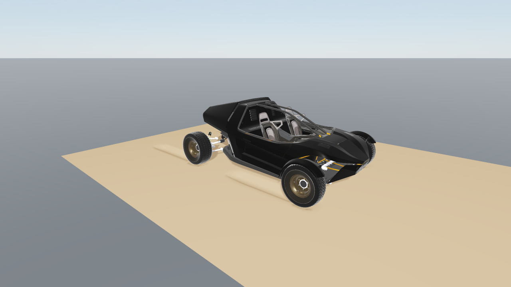
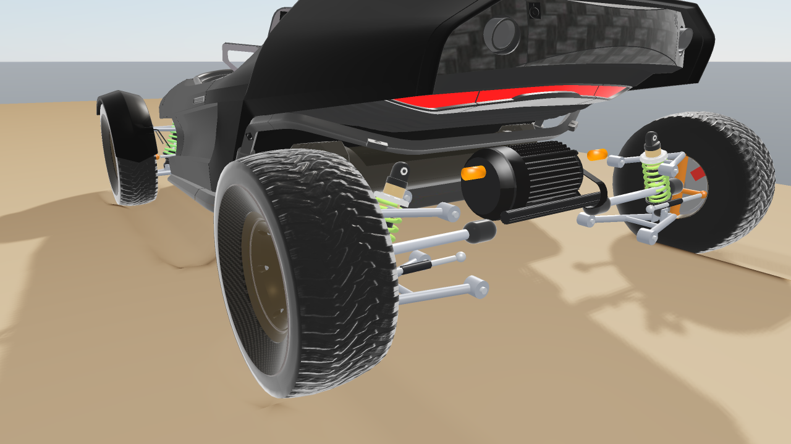
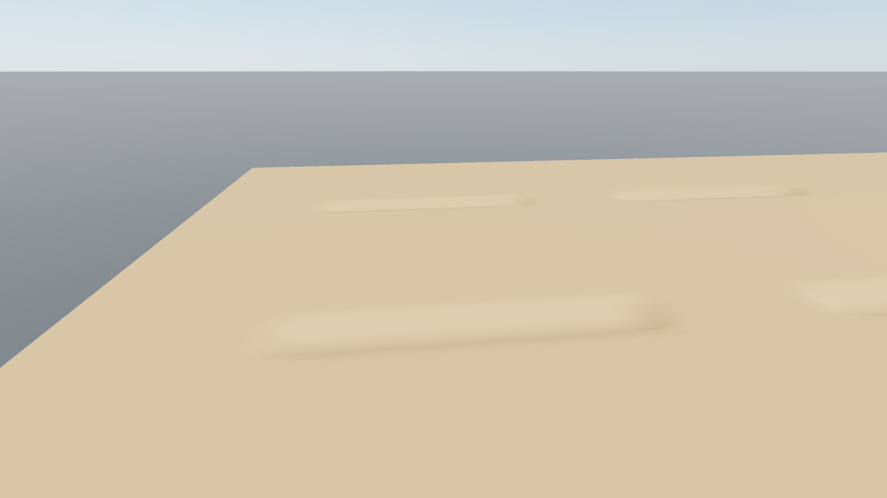
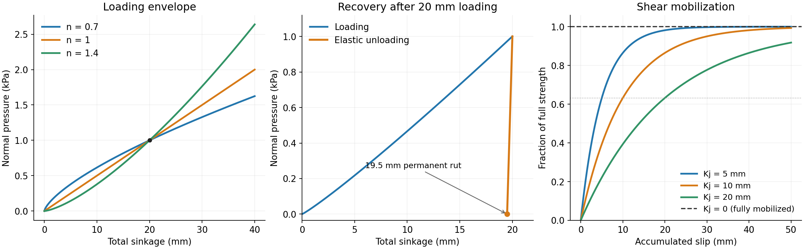
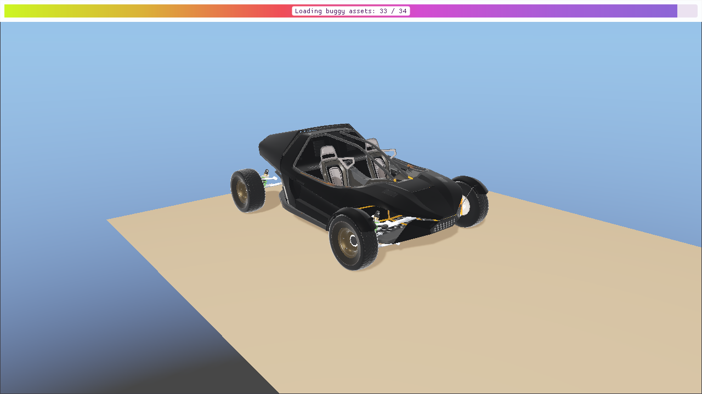

Deformable terrain
==================

``World::addDeformableTerrain`` creates a soil bed that deforms under rigid
bodies and articulated systems. Distributed normal pressure supports their
weight, while shear resistance provides traction. The model describes
pressure-dependent sinkage, elastic recovery, permanent ruts, and traction
buildup with slip.

   The example's 896 kg buggy driving across the bed.
   Rear-wheel drive supplies torque through the wheel joints; soil traction
   moves the chassis and the wheels leave ruts in the surface.

   Car visuals are based on
   `Sci - Fi Buggy <https://sketchfab.com/3d-models/sci-fi-buggy-085bd97876a64eacbc041299ac945e9c>`_
   by `TiyaMakes <https://sketchfab.com/tiyamakes>`_, licensed under
   `CC BY 4.0 <https://creativecommons.org/licenses/by/4.0/>`_. The meshes
   and textures are modified; the :download:`buggy asset credits <../../rsc/offroad_buggy/ATTRIBUTION.md>`
   describe the changes and redistribution requirements.

   The buggy's double-wishbone suspension distributes the vehicle load
   between the wheels. Springs and dampers respond as the wheels sink into
   the soil.

   The same bed after removing the car. Elastic displacement recovers and
   permanent ruts remain; surface heights are shown without vertical exaggeration.

Creating a bed
--------------

.. code-block:: cpp

   raisim::DeformableTerrain::Material soil;
   soil.bekkerKc = 0.0;
   soil.bekkerKphi = 4.0e4;
   soil.sinkageExponent = 1.1;
   soil.elasticStiffness = 2.0e6;
   soil.damping = 2000.0;
   soil.cohesion = 100.0;
   soil.frictionCoefficient = 0.6;
   soil.shearDisplacement = 0.01;

   const size_t nx = 201, ny = 101;
   auto* bed = world.addDeformableTerrain(
       nx, ny, 8.0, 4.0, 0.0, 0.0, std::vector<double>(nx * ny, 0.0), soil);
   bed->setName("soil");

Heights use ``height[y * nx + x]``. The bed covers the same local coordinate
range as :doc:`HeightMap`. You may place the bed with ``setPosition`` and ``setOrientation`` between steps. Deformation
and normal pressure act along the bed's local Z axis. The bed is static;
dynamic and kinematic body types are rejected.

The default values are illustrative parameters, not a calibrated material.
Choose the mesh spacing to resolve the footprint and the desired rut width;
2--5 cm is a useful starting point for robot feet and wheels of comparable size.
Finer spacing represents curved footprints and rut boundaries in more detail.

Constitutive model
------------------

For total downward displacement :math:`s`, permanent displacement :math:`s_p`,
and projected contact width :math:`b`, the normal pressure is

.. math::

   p(s,s_p,b) = \max\left(0,\min\left[
      K_e(s-s_p),\left(k_c/b+k_\phi\right)s^n\right]\right).

The effective width :math:`b` is the narrowest width of the collider's
footprint projected onto the bed plane: the shorter side of a flat box, the
tread width of a wheel whose axle lies in the bed plane, and the diameter of a
sphere or capsule. Mesh colliders use the footprint of their bounding box.
The width turns with the collider, so a body's heading does not change its
soil stiffness. This approximates contact width for general shapes; calibrate
the width-dependent term for the intended wheel or foot geometry.

The elastic branch :math:`K_e(s-s_p)` describes recoverable deformation, while
the Bekker envelope :math:`(k_c/b+k_\phi)s^n` limits the pressure before further
permanent compaction. Permanent sinkage never decreases: after loading,
:math:`s_p` retains at least :math:`s-p/K_e`. Removing the load recovers the
elastic displacement and leaves a rut of depth :math:`s_p`.

Penetration adds loading-only viscosity:

.. math::

   p_n = p + D\max(\dot{s},0).

Here :math:`\dot{s}` is the rate at which the body pushes the soil surface
down. A body above the surface, or above the floor of an existing rut, meets
no resistance until it reaches it; only its travel into the soil is damped.
The normal response is compressive; the soil supplies no suction when the
body lifts away.
Impact loading can produce deeper ruts than slow loading at the same final
weight.

Shear strength follows Mohr--Coulomb and Janosi--Hanamoto:

.. math::

   \tau_{\max} = (c+\mu p_n)(1-\exp[-j/K_j]).

Here :math:`j` is accumulated tangential slip while the surface is loaded.
Shear resistance opposes slip, with the same strength limit in every tangent
direction. ``shearDisplacement = 0`` selects fully mobilized friction immediately.
The normal pressure :math:`p_n` includes loading viscosity, while :math:`p`
denotes the non-viscous elastic/plastic part.

Material parameters
-------------------

``DeformableTerrain::Material`` defines the soil response for the entire bed.
These parameters use SI units: metres, seconds, and pascals (N/m\ :sup:`2`).
They describe pressure and shear stress per unit area. Total contact forces
are the corresponding stresses integrated over the loaded footprint. The
parameters describe the material and do not need rescaling with mesh spacing
or timestep.

.. list-table:: Defaults and valid values
   :header-rows: 1
   :widths: 30 22 16 32

   * - C++ member
     - Units
     - Default
     - Valid values
   * - ``bekkerKc``
     - :math:`\mathrm{Pa}\,\mathrm{m}^{1-n}`
     - ``0.0``
     - Finite, nonnegative
   * - ``bekkerKphi``
     - :math:`\mathrm{Pa}/\mathrm{m}^{n}`
     - ``2.0e5``
     - Finite, nonnegative
   * - ``sinkageExponent``
     - Dimensionless
     - ``1.1``
     - Finite, strictly positive
   * - ``elasticStiffness``
     - Pa/m
     - ``2.0e6``
     - Finite, strictly positive
   * - ``damping``
     - Pa s/m
     - ``1000.0``
     - Finite, nonnegative; zero disables viscosity
   * - ``cohesion``
     - Pa
     - ``0.0``
     - Finite, nonnegative
   * - ``frictionCoefficient``
     - Dimensionless
     - ``0.6``
     - Finite, nonnegative
   * - ``shearDisplacement``
     - m
     - ``0.01``
     - Finite, nonnegative; zero gives full mobilization

At least one of ``bekkerKc`` and ``bekkerKphi`` must be positive. Invalid
materials throw ``std::invalid_argument`` at construction. The API imposes no
upper bound on finite coefficients; acceptance does not establish that a
value represents a particular soil. The defaults and the softer example bed
above are illustrative rather than measured material presets.

Normal loading: ``bekkerKc``, ``bekkerKphi`` and ``sinkageExponent``
~~~~~~~~~~~~~~~~~~~~~~~~~~~~~~~~~~~~~~~~~~~~~~~~~~~~~~~~~~~~~~~~~~~~

The Bekker loading envelope is :math:`p_y=(k_c/b+k_\phi)s^n`.
Increasing either coefficient at a fixed exponent and footprint raises the
pressure at a given sinkage and reduces the equilibrium sinkage under the
same load, provided the elastic branch is not the limiting response.
``bekkerKc`` supplies the width dependence: its contribution increases as
:math:`b` decreases. ``bekkerKphi`` supplies the width-independent contribution.
Setting ``bekkerKc = 0`` removes this explicit width dependence, although the
footprint's area still affects force and its shape affects the pressure distribution.
Despite its name, ``bekkerKc`` is a normal pressure coefficient; it is distinct
from the tangential ``cohesion`` parameter.

For a flat plate with uniform pressure :math:`p_{\mathrm{load}}=mg/A` resting
on the yielding envelope, a useful analytical check is

.. math::

   s_{\mathrm{eq}} = \left(\frac{mg}{A(k_c/b+k_\phi)}\right)^{1/n}.

For example, a 20 kg, 0.4 by 0.6 m plate has :math:`A=0.24` m\ :sup:`2`,
:math:`b=0.4` m, and :math:`p_{\mathrm{load}}=817.5` Pa at
:math:`g=9.81` m/s\ :sup:`2`. With :math:`k_c=0`, :math:`k_\phi=10^5`, and
:math:`n=1`, the yielding-envelope sinkage is 8.175 mm. This is a quasistatic
reference for a uniform plate, not a prediction of transient impact depth or
of loading into an existing uneven rut. The elastic branch and accumulated
plastic state can determine the response instead.

``sinkageExponent`` controls the curvature of the loading envelope. Its
incremental stiffness is :math:`n(k_c/b+k_\phi)s^{n-1}`. With :math:`n=1`,
pressure is linear in sinkage. With :math:`n>1`, the incremental stiffness
increases with sinkage; with :math:`0<n<1`, it decreases. Changing :math:`n`
also changes the units of both Bekker coefficients. Comparing materials by
changing only :math:`n` while retaining the same numerical coefficients is
therefore misleading. To hold a reference pressure fixed with :math:`k_c=0`,
choose :math:`k_\phi=p_{\mathrm{ref}}/s_{\mathrm{ref}}^n` for each exponent.

Elastic recovery: ``elasticStiffness``
~~~~~~~~~~~~~~~~~~~~~~~~~~~~~~~~~~~~~~

``elasticStiffness`` is the pressure slope during elastic unloading and
reloading: :math:`p_e=K_e(s-s_p)`. It is a foundation stiffness per area,
not a Young's modulus in Pa or a spring constant in N/m. A uniform area
:math:`A` has elastic force stiffness :math:`A K_e` in N/m. At pressure
:math:`p`, the recoverable displacement on this branch is :math:`p/K_e`.

For example, 1000 Pa with :math:`K_e=2\times10^6` Pa/m gives 0.5 mm of
recoverable sinkage. Increasing :math:`K_e` reduces this recovery and steepens
the unloading/reloading slope. It does not raise the Bekker yield envelope:
normal pressure remains the smaller of the elastic and yielding pressures.
At a fixed peak sinkage on the envelope, a larger :math:`K_e` leaves a larger
permanent fraction through :math:`s_p=s-p_y/K_e`. If the elastic stiffness is
too low relative to the desired loading envelope, the response can remain
mostly elastic and produce much less permanent rutting. Fit this parameter
from unloading/reloading data rather than treating it as a general hardness
control. Completely unloaded soil recovers to its permanent depth; the model
has no independent delayed relaxation.

Loading rate: ``damping``
~~~~~~~~~~~~~~~~~~~~~~~~~

``damping`` adds pressure :math:`p_v=D\max(\dot{s},0)` during penetration.
For example, :math:`D=2000` Pa s/m and a loading speed of 0.1 m/s add
200 Pa. Increasing it raises transient resistance and dissipation during
loading; it does not alter the equilibrium pressure when the loading speed
is zero. It supplies no viscous suction or tensile force during unloading.
Zero removes the viscous term while retaining the elastic/plastic response.

The total normal pressure :math:`p_n=p+p_v` also enters the frictional strength,
so increasing damping can raise transient shear resistance as well as normal
resistance. Calibrate rate effects separately from the Bekker envelope and
check the intended impact speeds. This local viscosity does not represent
soil mass, wave propagation, or a volumetric viscoelastic continuum.

Shear strength: ``cohesion`` and ``frictionCoefficient``
~~~~~~~~~~~~~~~~~~~~~~~~~~~~~~~~~~~~~~~~~~~~~~~~~~~~~~~~

The fully mobilized shear stress is :math:`\tau_f=c+\mu p_n`.
``cohesion`` sets its pressure-independent intercept. For example,
:math:`c=100` Pa contributes 10 N over a loaded 0.1 m\ :sup:`2` patch when
fully mobilized. ``frictionCoefficient`` sets the pressure-dependent slope;
:math:`\mu=\tan\phi` if expressing it as a friction angle :math:`\phi`.
At :math:`p_n=1000` Pa, :math:`c=100` Pa and :math:`\mu=0.6`, the fully
mobilized stress is 700 Pa. The displacement law below can reduce the
available stress before mobilization.

Increasing either parameter raises available traction at the same normal
pressure and shear history. With ``frictionCoefficient = 0``, nonzero
``cohesion`` can still resist slip while contact is loaded. Setting both to
zero removes tangential resistance. Cohesion does not bond a body to the
surface or create a tensile normal force when it lifts away.

These soil parameters govern the distributed terrain contact law. The rigid
material-pair friction and restitution settings in :doc:`MaterialSystem` do
not tune this constitutive response. Use the soil's ``Material`` for its
traction and loading response, and material pairs for ordinary rigid contacts.

Traction buildup: ``shearDisplacement``
~~~~~~~~~~~~~~~~~~~~~~~~~~~~~~~~~~~~~~~

``shearDisplacement`` is the Janosi--Hanamoto displacement scale :math:`K_j`:

.. math::

   \frac{\tau_{\max}}{c+\mu p_n}=1-\exp(-j/K_j).

For positive :math:`K_j`, the strength reaches approximately 63.2% at
:math:`j=K_j`, 95% at :math:`j=3K_j`, and 99% at :math:`j=4.605K_j`.
With the default 0.01 m scale, those displacements are 10, 30, and 46.05 mm.
A smaller scale builds traction over less slip; a larger scale produces
slower buildup and more creep before reaching the same strength. Setting
zero selects fully mobilized friction immediately, including any cohesion.

The history is accumulated slip displacement at a loaded soil patch,
not elapsed time, commanded wheel travel, or body displacement in free flight.
It grows while a patch is loaded and resets when that patch unloads. Permanent
sinkage survives unloading separately. A new footprint therefore does not
inherit the shear history of an unloaded rut. Fit :math:`K_j` as a physical
slip displacement scale, independently of the terrain mesh spacing.

   Constitutive curves for the dynamics model. The loading
   curves share 1000 Pa at 20 mm; the recovery example unloads with
   :math:`K_e=2\times10^6` Pa/m. The shear plot shows different displacement
   scales and the fully mobilized zero-scale case. These are illustrative
   responses rather than measured soil data.

Calibrating a material
~~~~~~~~~~~~~~~~~~~~~~

1. Measure slow plate-loading curves at several widths and loads. Fit
   :math:`n` and the two Bekker coefficients together. At a fixed :math:`n`,
   plotting :math:`p/s^n` against :math:`1/b` gives slope :math:`k_c` and
   intercept :math:`k_\phi`. A single width identifies only their sum
   :math:`k_c/b+k_\phi`; it cannot identify both coefficients separately.
   Use the same projected-width convention as the colliders being simulated.
2. Measure unloading/reloading slopes to fit :math:`K_e`, including recovered
   depth and the remaining rut. Fit the loading envelope and elastic branch
   consistently; the normal pressure is their minimum.
3. Repeat indentation at different speeds to fit :math:`D` from the extra
   loading pressure, after accounting for quasistatic pressure. Recheck impact
   compaction rather than fitting only the final resting depth.
4. Measure shear stress versus displacement at several normal pressures.
   Fit :math:`c` and :math:`\mu` to the fully mobilized stresses, then fit
   :math:`K_j` to the buildup curves. Include low-speed slip if creep matters.
5. Validate with the intended feet or wheels, loads, speeds, mesh spacing and
   timestep, including unloading and repeated passes. Compare sinkage,
   recovered depth, force and traction histories as well as final poses.
   Agreement with an analytical plate case alone does not establish accuracy
   for a particular soil or for phenomena outside the supported model.

Terrain state and saving
------------------------

``getSoilState()`` returns three arrays with one value per vertex:
``sinkage``, ``plasticSinkage``, and ``shear``. They represent total downward
displacement, permanent downward displacement, and accumulated loaded slip,
respectively. ``setSoilState`` restores these arrays. ``resetSoil``
returns to the undeformed mesh. Call state setters between complete steps.
HeightMap height-edit APIs are rejected for this subclass because they bypass
soil history. ``getUndeformedHeights`` returns the original surface.

``getSoilStepStats()`` describes the last step. ``contacts`` counts the
quadrature contacts near bodies, including those a body approaches but has
not yet loaded. ``contactArea`` and ``normalForce`` are the area and total
normal force of the loaded contacts. A soil contact's ``getDepth()`` is its
separation from the floor of the current rut: positive while the body
approaches, negative while it compresses the soil.

World checkpoints capture the soil history and support deterministic replay.
XML export saves original heights and the complete state. To author a soil
bed in a world XML file, use explicit height samples and a ``soil`` child:

.. code-block:: xml

   <heightmap name="soil" x_size="2" y_size="2" x_sample="3" y_sample="3"
              height="0 0 0 0 0 0 0 0 0">
     <soil bekker_kc="0" bekker_kphi="40000" sinkage_exponent="1.1"
           elastic_stiffness="2000000" damping="2000" cohesion="100"
           friction_coefficient="0.6" shear_displacement="0.01"/>
   </heightmap>

Soil XML currently requires ``height``; generate or load a height array in C++
when starting from PNG, text, or procedural terrain. Exported soil elements
also contain ``sinkage``, ``plastic_sinkage``, and ``shear`` arrays.

For terrain-only contacts on articulated systems, the solver packs the fixed
impulse-response matrices once per physics step and uses vectorized updates
of the generalized velocities. When a second sweep is needed, it packs padded
Jacobian columns once so all three contact-velocity components can use vector instructions,
while retaining each component's original summation order. The responses include
the suspension's eliminated pin and equality constraints. Contact order, quadrature samples,
material equations, and convergence tolerances remain the same.

When an articulated terrain solve needs more than four sweeps, sufficiently
large contact groups can use six-component velocity and force/torque coordinates
for each contacting link. Setup is attempted only when the residual after four
sweeps still exceeds 1,000 times the existing stopping threshold, so solves near
convergence retain the cheaper full-coordinate updates. Each quadrature point still receives its own normal
and shear solve, with its original apparent inertia, material history, and
residual tolerances. While consecutive points on one link are visited, changes
to other links accumulate as force and torque. Their coupled velocity is updated
before the next contact on another link is read. The Gauss-Seidel contact order
and stopping criteria are retained; contacts are never merged.

The six-direction basis is rebuilt from well-separated points in the current
step. Every original sparse Jacobian and every full generalized impulse response
must pass reconstruction checks at double-precision roundoff before this path
is enabled. The responses include eliminated pin and equality constraints.
Small groups and poorly conditioned geometry continue through the full
articulated update. At the end of the solve, the original point responses update
all generalized velocities, including passive joints absent from the contact
Jacobians. This reduction can change floating-point summation order; it changes
neither the mesh resolution, timestep, constitutive equations, nor solver
accuracy settings.

The solver also seeds mesh-soil contacts with the last converged traction on
the same bed and body link. The cache sorts contact positions by X to limit
nearest-point searches to the contact matching radius. It keeps them apart
from the same body's rigid contacts, so the search cost stays linear when a
body rests on soil and on a rigid support at once. Quadrature points are
matched one to one; the cached traction is scaled by the current contact
area and timestep and projected into the current soil strength bound. Impacts, unmatched points,
and stale or non-converged cache entries receive a cold start. Current soil
history and material forces are still solved each step at the existing
convergence tolerances. Normal and shear updates continue iterating until
their coupled force converges, including an isolated contact.

Warm starting changes the numerical iteration path, so a cold-start trajectory
need not be bit-for-bit identical. Set
``world.getContactSolver().getConfig().terrainWarmStart = false`` to disable
cached traction guesses while keeping the same mesh, timestep, material equations,
and tolerances. World checkpoints include this configuration and cache for
deterministic replay.

Within each coupled solve, shear updates also reuse the previous scalar root
as an initial guess inside the current analytic bracket, in both compliance
and shift coordinates. The current slip, normal load, and shear strength are
evaluated again before a root is accepted, using the same constitutive residual
tolerance. A valid seed avoids evaluating unused bracket endpoints; the solver
verifies a feasible endpoint if its safeguarded iterations exhaust their limit.
It retains the impulse already evaluated at the accepted root. These guesses
reset at the start of each physics step.

The scalar shear roots use Newton for small corrections and safeguarded Halley
updates for larger corrections, including the curvature of the
displacement-dependent shear strength. This reduces repeated
constitutive evaluations without changing the force equations. An update is
accepted only after re-evaluating the current residual on the feasible side of
the original tolerance. Poorly scaled curvature uses Newton, and proposals
outside the current bracket use bisection. The fixed tangential matrix from
that residual evaluation is reused in the derivative calculations.

Normal warm seeds also reuse the reciprocals of the fixed elastic loading and
unloading slopes. These are separate because loading includes the material's
viscous term. Yield branches retain their nonlinear slope calculation. Each
nonzero warm residual still receives a correction before acceptance, and the
updated pressure and depth must pass the same normal residual tolerance.
For nonlinear warm seeds, a conservative tangent below the convex Bekker
pressure envelope can certify an interval where the elastic branch wins.
The interval is constructed only when an elastic warm seed needs it, and a
new ordinary pressure anchor invalidates it.
Inside that interval, one exact elastic correction replaces the general Newton
loop when loading or unloading does not change. The updated pressure is still
checked against the original normal residual tolerance. An envelope crossing,
a viscous loading transition, an unsupported exponent, or a poorly scaled
interval retains the safeguarded solve.

When the sinkage exponent is one, both pressure branches are affine. The solver
computes the four elastic/yield and loading/unloading depth candidates from
coefficients fixed for the current physics step. Taking the minimum of each
branch's loading/unloading candidates and then the maximum of the two pressure
candidates solves the same piecewise pressure equation directly. It evaluates
the current pressure and residual before acceptance; poorly scaled coefficients
and candidates that fail the existing tolerance use the iterative solve.

Warm shear visits can also use a fixed compliance cap from the tangential
mobility matrix. A conservative bound using the current normal load, shear
history, and tangential velocity components proves the cap feasible before it
replaces the more expensive analytic bracket calculation. If that proof fails,
the original analytic bracket is calculated. Both paths evaluate the current
slip-dependent force at the same tolerance.

All of these scalar caches reset each physics step.

For bodies with many terrain quadrature points, dense pin elimination projects
six spatial impulse directions once per body. Each point's response and pin
coupling are recovered from those directions and its lever arm. This uses the
linearity of the current mass-weighted projection; it retains every contact
point and recomputes the mass response and constraint factorization each step.
Smaller constraint or contact groups, tracked bodies, and the structured pin factorization
use the existing per-contact projection.

The ``deformable_terrain`` benchmark accepts ``--body=articulated`` to measure
a 60-DOF plate with the same analytical load and sinkage checks as its default
rigid plate. ``--body=pinned`` adds eight independent joint relations to
exercise the shared suspension projection with the same analytical load.
``--body=multilink`` uses a 64-DOF body supported by four separate articulated
pads with horizontal sliders, retaining the same total 20 kg load and
0.24 square metre footprint. This exercises coupling between contacting links
and checks sinkage against the same analytical pressure law.
Compare ``--start=warm`` (default) and ``--start=cold`` to measure
warm starting at the same accuracy settings; each case reports solver sweeps
and analytical sinkage error. Use one CPU thread for timing comparisons.

Add ``--contact-law`` to time the normal and shear updates independently of
collision detection and articulated-body calculations. This workload visits
32 anisotropic point contacts with changing loads and slip speeds, covering
fresh, partially mobilized, and fully mobilized shear histories. It verifies
normal pressure, shear feasibility, tangential alignment, and dissipation after
each timed run. For example::

   ./benchmarks --bench deformable_terrain --raisim -- --contact-law --start=warm --steps=10000 --repeats=3

Use ``--start=cold`` for the same inputs with fresh scalar solve state at every
visit. Add ``--material=linear`` to isolate the piecewise affine pressure solve;
the default is ``--material=nonlinear`` with exponent 1.1. Both material options
retain displacement-dependent shear and the same force checks. This microbenchmark complements the full mesh and vehicle workloads;
its timing does not include mesh updates, collision queries, or suspension
constraints.

Model scope
-----------

This is a surface terramechanics model for a supported bed. The surface deforms
only along the bed's local Z axis. It represents distributed support,
permanent compaction, elastic recovery, loading viscosity, and slip-dependent
traction for rigid bodies and articulated systems.

The model does not include soil inertia, lateral soil transport,
displaced-volume berms, excavation, overhangs, or failure planes. It is not a
volumetric continuum model.

The soil has no contact model for granular media or deformable objects
(cloth and volumes), so a world cannot hold a deformable terrain together with
either. Adding the second of them is a fatal error (``RSFATAL``), whichever is
added first and also while a world XML file loads, so the combination fails
before any simulation step.

Vehicle example
---------------

The ``rayrai_deformable_terrain`` example drives an 896 kg off-road buggy over
a 16 m by 6 m soil bed. It uses the same vehicle model as
:doc:`examples/rayrai/rayrai_offroad_buggy`: double-wishbone suspension,
coil springs and dampers, rack-and-pinion steering, and tyre compliance.
The cylindrical wheel colliders have radius 0.3611 m and contact widths
of 0.126 m in front and 0.1562 m at the rear.

While meshes load, the example shows the same loading bar as the forest
example. Its gradient and deep-purple label use the colors from the RaiSim
logo. Physics stays paused until the assets are ready, then driving starts
without a settling phase.

   The shared loading bar stays above the viewer while the simulation clock
   remains at zero.

The bed uses ``bekkerKphi = 2.0e6``, ``elasticStiffness = 2.0e7``,
``damping = 4.0e4``, ``sinkageExponent = 1.1``, and ``cohesion = 100``.
Other material fields retain their defaults. These parameters demonstrate
wheel sinkage, permanent ruts, and traction; they are not measurements of a
particular soil. Rear-wheel drive requests about 0.8 m/s, with the actual speed
determined by sinkage, slip, and soil resistance.
