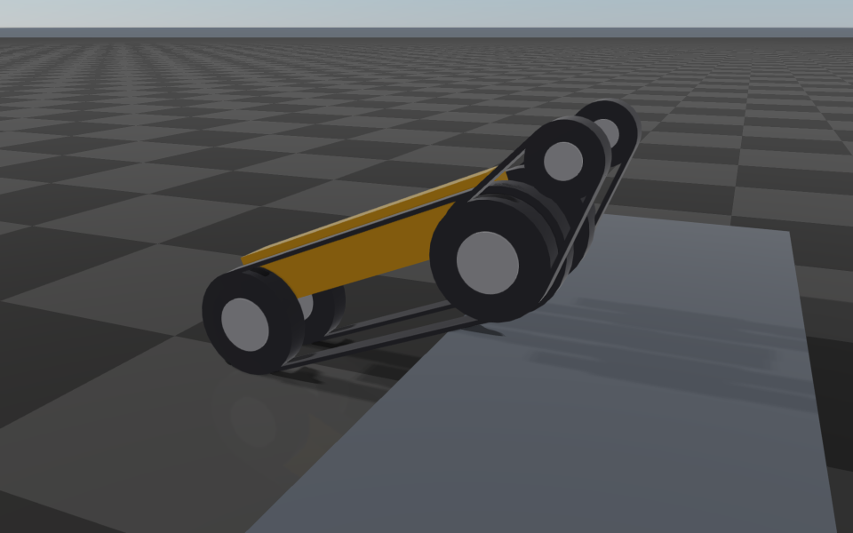

#############################
Tracks
#############################

A track is a continuous belt wrapped around wheels of one link. RaiSim simulates it as a rigid belt
whose surface moves along the loop: the belt is a collision shape of the link that carries it, and
its surface speed comes from the joints that drive it. A contact on the belt therefore pulls on
those joints, so a drive torque moves the robot through friction, a blocked robot stalls its
drives, and the drives are controlled like any other joint (PD targets, torques or
:doc:`../Actuators`).

Describing a track
==================

Tracks are written in the URDF with the ``<track>`` element, a child of ``<robot>``:

.. code-block:: xml

    <track name="left" link="base_link" width="0.08" thickness="0.015" material="rubber">
        <axis xyz="0 1 0"/>
        <wheel joint="left_sprocket" radius="0.178"/>   <!-- center: the joint's origin -->
        <wheel xyz="-0.5 0.14 0" radius="0.178"/>      <!-- center: a point in the link frame -->
        <drive joint="left_sprocket" gain="0.178"/>
    </track>

.. list-table::
   :header-rows: 1
   :widths: 22 78

   * - Element
     - Meaning
   * - ``name``
     - Track name (unique in the robot).
   * - ``link``
     - The link that carries the belt. The belt is rigidly attached to it; a link fixed to its parent
       is merged into the parent as usual. It can be the fixed base of the robot (see
       `Conveyors`_).
   * - ``width``
     - Belt width along the axis [m].
   * - ``thickness``
     - Belt thickness [m]: the belt's outer surface lies this far outside the wheels.
   * - ``material``
     - Collision material of the belt (optional), for :code:`World::setMaterialPairProp()`.
   * - ``color``, ``visual``
     - Color of the belt's visual (``"r g b a"``, optional), and ``visual="false"`` to draw no belt,
       for robots whose meshes already show it.
   * - ``<axis xyz>``
     - The axis the wheels turn about, in the link frame.
   * - ``<wheel>``
     - A wheel the belt wraps, with its ``radius``. Its center is the origin of ``joint`` (a child
       joint of ``link`` whose axis is parallel to the track axis) or the point ``xyz`` in the link
       frame. At least two wheels, all in one plane perpendicular to the axis.
   * - ``<drive>``
     - A revolute, continuous or prismatic ``joint`` of the same robot that moves the belt, with its
       ``gain``: the belt speed per unit joint velocity (the pitch radius [m] of a sprocket, a ratio
       for a prismatic joint). At least one; several add up.

The belt speed is

.. math::

    s = \sum_k g_k\, u_k = \boldsymbol{g}^T \boldsymbol{u},

with the gains :math:`g_k` of the drives and their joint velocities :math:`u_k`. A sprocket that
drives the belt with its pitch radius :math:`r` gives :math:`s = r\,u_\mathrm{sprocket}`, the speed of
its rim. A belt that is not driven (an idler track) still needs a drive: give it a passive joint
without gains, and the belt rolls freely.

Several drives describe a belt that moves relative to a moving link. A flipper whose belt is run by
a pulley on the sprocket's shaft moves its belt at :math:`r\,(u_\mathrm{sprocket} - u_\mathrm{flipper})`
relative to the flipper:

.. code-block:: xml

    <track name="left_flipper" link="left_flipper" width="0.08" thickness="0.015">
        <axis xyz="0 1 0"/>
        <wheel xyz="0 0 0" radius="0.16"/>
        <wheel xyz="0.35 0 0" radius="0.088"/>
        <drive joint="left_sprocket" gain="0.178"/>
        <drive joint="left_flipper_joint" gain="-0.178"/>
    </track>

The loader rejects a track that cannot be built: unknown links or joints, wheels off the plane,
a wheel inside another, a wheel inside the belt (a rigid belt wraps the convex hull of its wheels),
a wheel joint whose axis is not parallel to the track's, a missing ``<drive>``, a zero gain, and a
wheel link with its own collision geometry. The belt is the contact surface; a wheel that also
collided would touch the ground beside it, so remove the wheel's ``<collision>`` (keep its
``<visual>``). The belt of another track on the wheel link, such as that of a flipper pivoting about
the wheel's axis, is not the wheel's own geometry; the order of the ``<track>`` elements does not
matter.

Geometry
========

The belt wraps the convex hull of its wheels, ``thickness`` outside them. Its collision geometry
is a cylinder around each wheel it wraps (wheel radius plus thickness, ``width`` long) and a box
along each straight run, reaching from the outer surface inwards to the nearer wheel center, so a
track is solid and nothing can enter it between the upper and lower runs. A wheel that only
touches the belt on a straight run, such as a road wheel between two others of the same size,
adds no cylinder. The same shapes are drawn as the belt's visuals.

The collision bodies belong to the link and are listed in :code:`Track::collisionBodies` (indices
into :code:`getCollisionBodies()`). They never collide with other collision bodies of the same link,
and, unless the system's option says otherwise, not with those of the parent link either.

Dynamics
========

Where the belt's outward surface normal is :math:`\boldsymbol{n}`, its surface moves at

.. math::

    \boldsymbol{v}_\mathrm{belt} = s\,(\boldsymbol{a} \times \boldsymbol{n})

relative to the link, with the track axis :math:`\boldsymbol{a}`: the same as the rim of a wheel of
radius :math:`g` turning about :math:`\boldsymbol{a}`. A positive speed runs the belt
counter-clockwise seen from :math:`+\boldsymbol{a}`; with the axis along the robot's :math:`+y`, the
lower run moves backwards and the robot forwards. A point of the belt in contact moves with the
link plus this surface velocity, so the Jacobian of the contact is

.. math::

    \boldsymbol{J} = \boldsymbol{J}_\mathrm{link} + \boldsymbol{t}\,\boldsymbol{g}^T,

with the belt direction :math:`\boldsymbol{t}` at the contact. The contact impulse
:math:`\boldsymbol{\lambda}` acts on the link at the contact point and, through
:math:`\boldsymbol{g}\,(\boldsymbol{t}^T\boldsymbol{\lambda})`, on the drive joints. The belt is an
ideal, massless transmission:

* it does no work: the power of the traction equals the power of the drive torques;
* a belt that grips the ground moves the robot at the belt speed, and a drive torque
  :math:`\tau` pushes it with the traction :math:`\tau / g`; the robot accelerates with its mass
  plus the reflected inertia :math:`I / g^2` of each drive;
* the traction is bounded by friction: beyond :math:`\mu` times the load, the belt slides;
* a robot that cannot move (blocked by a wall) holds its belts still, and the drives stall at
  their torque limit;
* turning in place, the belts slide sideways over the ground and the turning rate follows from
  the drive torques and the friction.

The belt has no mass of its own. Add its inertia to a drive joint's ``rotor_inertia``: a belt of
mass :math:`m_\mathrm{belt}` driven with gain :math:`g` adds :math:`m_\mathrm{belt}\,g^2`.

**Load across the belt.** A belt carries its load to the wheels, which lie on its mid-plane (the
plane through the wheel centers perpendicular to the axis); across its width it is flexible. A
contact with the ground, a heightmap or another static or kinematic body therefore pushes on the
robot at the mid-plane, wherever across the width it touches: the two tracks share the weight as
their wheels do, and a robot turning in place does not slide sideways because one belt pressed
on its inner edge and the other on its outer edge. A contact with a dynamic body acts where it
touches on both bodies.

**Contacts that coincide.** On a flat surface a belt touches with the corners of its boxes and the
ends of its cylinders, which meet at the two ends of its footprint. Contacts of one belt at the same
place (within 1% of its width) with the same normal against the same static or kinematic body are
one contact: the deepest of them carries the impulse, and the others report a zero impulse
(their rows in :code:`World::getContactProblem()` have rank
:code:`raisim::contact::rank::OBJECT_SOLVED_CONTACT`). The motion is the same; the step is faster.

Conveyors
---------

A track on the fixed base of a robot, or on a link fixed to it, is a conveyor: the belt stays in
place and only its surface moves. It carries the dynamic objects that touch it, and they load its
drives like the ground loads the drives of a vehicle:

.. code-block:: xml

    <robot name="conveyor">
        <link name="world"/>
        <joint name="mount" type="fixed">
            <parent link="world"/><child link="frame"/><origin xyz="0 0 0.5"/>
        </joint>
        <link name="frame"/>
        <link name="roller_link"> ... </link>
        <joint name="roller" type="continuous">
            <parent link="frame"/><child link="roller_link"/><origin xyz="1 0 0"/><axis xyz="0 1 0"/>
        </joint>
        <track name="belt" link="frame" width="0.5" thickness="0.02">
            <axis xyz="0 1 0"/>
            <wheel joint="roller" radius="0.1"/>
            <wheel xyz="-1 0 0" radius="0.1"/>
            <drive joint="roller" gain="0.1"/>
        </track>
    </robot>

The belt moves the dynamic objects it touches; the other links of its own robot touch it as a fixed
surface.

Limitations
-----------

* The belt is rigid: it keeps the shape of its wheels' hull. Belt sag, tension, suspension and road
  wheels that push the belt out of the hull are not simulated.
* Grousers act only through the friction coefficient of the belt's material.
* Skid steering obeys friction. Turning, the belts slide sideways; the friction that resists the
  turn grows with the length :math:`L` of the footprints and the steering moment of the belts with
  their distance :math:`B`. With the load spread evenly, a robot turns in place only if
  :math:`L < 2B` (the steering moment :math:`\mu W B / 2` of two belts pulling in opposite
  directions against the resistance :math:`\mu W L / 4` of a weight :math:`W`). The example robot
  below, with 1 m long footprints 0.28 m apart, drives straight over its steps but hardly turns.
* On flat, rigid ground a robot stands on the four ends of its two footprints, and how its weight
  splits between the diagonals is not determined by the rigid bodies. Driving straight, every split
  moves the robot the same way. Turning in place, the belts slide, and a robot whose center of mass
  is off the middle of its footprints drifts slowly while it turns: about 3 cm/s at 0.46 rad/s
  for a center of mass 2 cm in front of the middle of 0.8 m long footprints 0.5 m apart. A robot
  with its center of mass in the middle turns in place.

Controlling and reading a track
===============================

The drives are ordinary joints. Velocity control of the sprockets drives the robot:

.. code-block:: cpp

    Eigen::VectorXd kp = Eigen::VectorXd::Zero(robot->getDOF()), kd = kp, velocityTarget = kp;
    for (const char* sprocket : {"left_sprocket", "right_sprocket"}) {
      kd[robot->getGeneralizedVelocityIndex(sprocket)] = 50.;
      velocityTarget[robot->getGeneralizedVelocityIndex(sprocket)] = 5.;  // 0.89 m/s with a 0.178 m pitch radius
    }
    robot->setPdGains(kp, kd);
    robot->setPdTarget(Eigen::VectorXd::Zero(robot->getGeneralizedCoordinateDim()), velocityTarget);

.. list-table::
   :header-rows: 1
   :widths: 40 60

   * - Method
     - Returns
   * - :code:`getTracks()`
     - The tracks (:code:`raisim::Track`): name, link and its body index, axis, width, thickness,
       drives (joint, gain, generalized-velocity index) and collision bodies.
   * - :code:`getTrackIndex(name)`
     - The index of a track, or :code:`size_t(-1)`.
   * - :code:`getTrackSpeed(index)`
     - The belt speed :math:`s` [m/s].

The traction a drive delivers is its joint's generalized force (:code:`getGeneralizedForce()`), and the
contacts on a belt are the contacts of its link whose collision body is one of
:code:`Track::collisionBodies`. With :code:`setComputeInverseDynamics(true)`, the torque at a drive
joint (:code:`getTorqueAtJointInWorldFrame()`) includes the pull of the belt,
:math:`g\,(\boldsymbol{t}^T\boldsymbol{\lambda})/\Delta t` over the contacts on it: a stalled
sprocket reads the torque it transmits to the belt.

Example
=======

:doc:`../examples/server/templated_tracked_robot` drives a tracked robot with two flippers over a
row of steps. Its URDF template, ``rsc/templatedTrackedRobot/trackedTemplate.urdf``, describes four
tracks: one on each side of the body, driven by the front sprockets, and one on each flipper,
driven by the same sprockets through the flipper pulleys.
