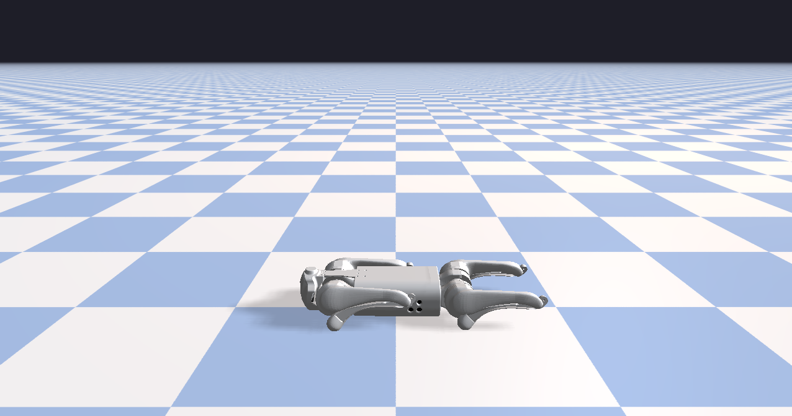

# Rayrai Example: Basic Scene

## Overview

Minimal scene with Go1 on a textured ground plane. It is a quick sanity check for loading a robot and rendering a basic environment.

## Screenshot



## Target

CMake target: `rayrai_basic_scene`.

## Run

Run the build-tree executable:

```bash
./build-examples/examples/rayrai_basic_scene
```

On Windows, run `rayrai_basic_scene.exe` instead.
This example renders in process with rayrai and does not need `rayrai_tcp_viewer`.

## Details

- Loads the Go1 URDF, sets a nominal standing pose, and adds a ground plane.
- Sets a background color and a checkerboard ground texture.
- Minimal render loop for a basic rayrai scene.
