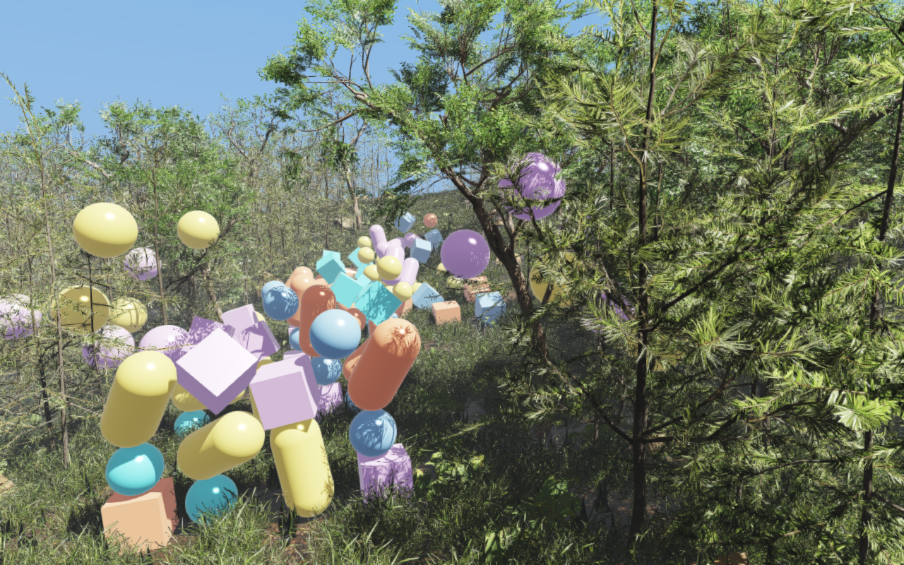

######################################
Rayrai Example: Forest From .rscene
######################################

Overview
========
Builds the :doc:`rayrai_forest` world from its saved RaiSim Engine scene,
``rsc/forest/rayrai_forest.rscene``, instead of placing every tree, plant and
rock in C++. The whole example is a few lines:

.. code-block:: cpp

   auto world = std::make_shared<raisim::World>(
     exampleRscPath(argv[0], "forest/rayrai_forest.rscene"));
   raisin::RayraiWindow viewer(world, 1280, 800);  // applies the scene

``raisim::World(path)`` reads the solver settings, the 161 × 161 heightmap,
the 2,068 hidden ``.rasset`` tree and rock collision bodies and the 100
dynamic props. The ``RayraiWindow`` applies the scene's render settings, sky and
weather, sun, ground texture, the 16 instanced vegetation and rock batches,
and the saved camera. The result simulates exactly like ``rayrai_forest``.

Target
======
CMake target: ``rayrai_forest_from_rscene`` (C++20). Source:
``examples/src/rayrai/worlds/rayrai_forest_from_rscene.cpp``.

The example needs the ``.rscene`` support in ``raisim::World`` and a rayrai
whose ``RayraiWindow`` applies its world's scene, which are not in a released
package yet. CMake skips this target when the installed rayrai lacks them.

Run
===
The example takes no arguments. It finds the scene in the ``rsc`` folder that
CMake copies next to the executables:

.. code-block:: bash

   ./build-examples/examples/rayrai_forest_from_rscene

On Windows, run ``rayrai_forest_from_rscene.exe`` from ``build-examples\bin``.
The example renders in process and does not need ``rayrai_tcp_viewer``.
Meshes load asynchronously behind a loading bar; physics starts once they are
ready and then runs eight 2 ms steps per rendered frame. The mesh LOD caches
described in :doc:`rayrai_forest` are shared with that example.

Changing the render settings
============================
The scene file stores the rendering parameters: the quality preset and custom
renderer settings (MSAA, shadow resolution and cascades, exposure, tone
mapping and post effects), the environment (color mode, fog, bloom, SSAO) and
the weather. To change them in C++, pass them to
``setRsceneRenderSettings``, which applies the scene again with them in place
of the viewer's constructor:

.. code-block:: cpp

   auto render = raisin::rsceneRenderSettings(*world->getRscene());
   render.quality.viewerMsaaSamples = 8;
   render.weather.timeOfDayHours = 18;
   raisin::setRsceneRenderSettings(viewer, render);

With weather enabled, rayrai derives exposure, environment intensity, fog and
shadow strength from these base settings and the sky, so overriding them here
keeps that relationship. The viewer's own setters still change anything
afterwards.

Supported scene content
=======================
The reader supports what a terrain-and-props scene uses: physics settings,
materials, a sampled heightmap with its base texture, box, sphere, cylinder,
capsule, ground and static ``.rasset`` bodies, instanced mesh visuals, a
directional light, cameras and the render environment. Editor-only records
are skipped. Anything it cannot reproduce exactly, such as articulated
systems, sensors, parented nodes, painted terrain, non-directional lights or
mesh bodies without a ``.rasset``, is a fatal error naming the line.
:doc:`../../RsceneFile` documents every record and field of the format.

See :doc:`../../WorldSystem` for the ``World`` constructor and
:doc:`rayrai_forest` for the assets, scatter and performance notes.
