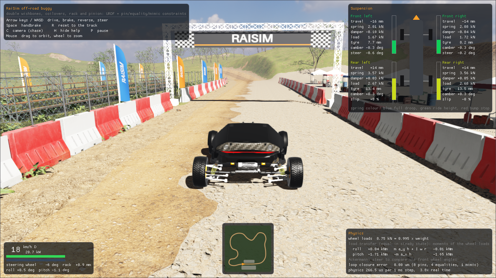
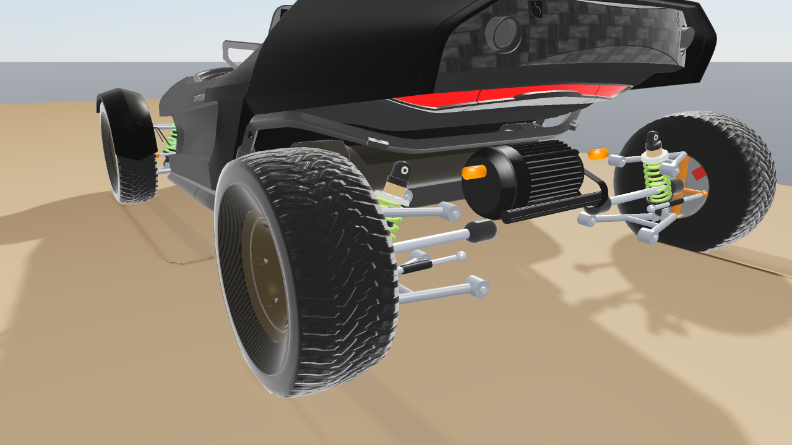
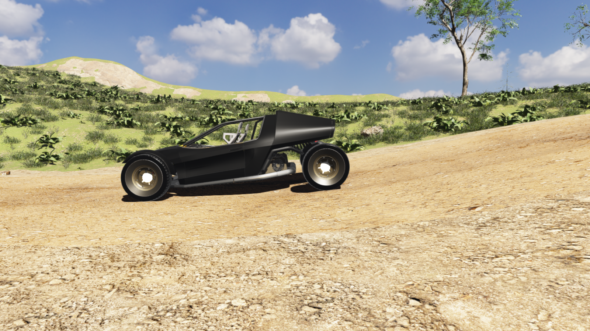
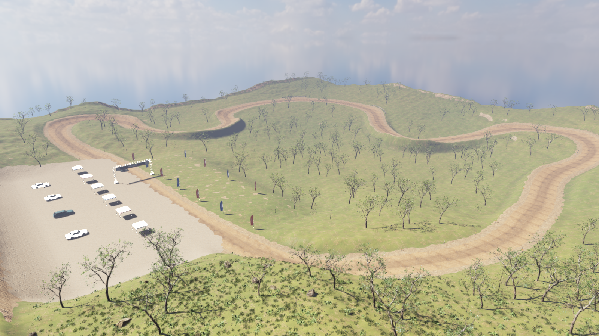
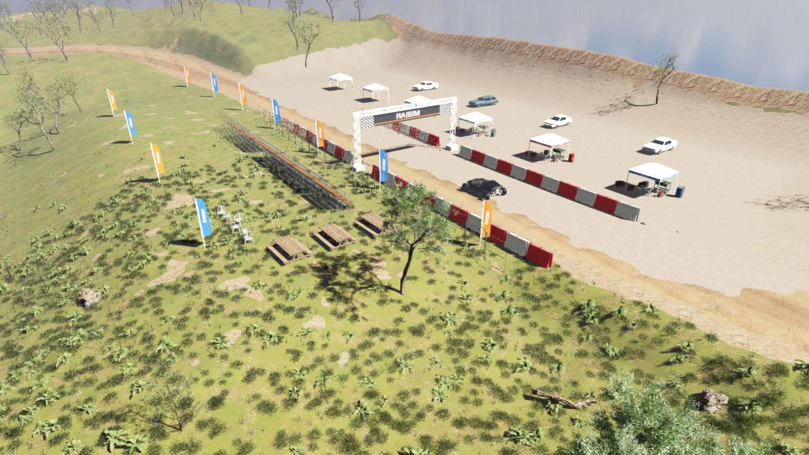
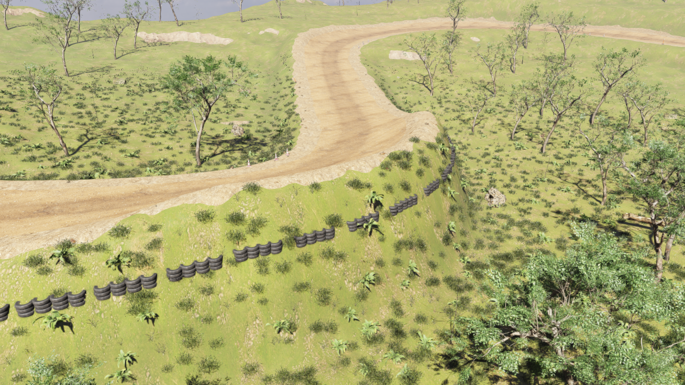

###############################
Rayrai Example: Off-Road Buggy
###############################

Overview
========
An off-road buggy with independent double-wishbone suspension, driven with the
arrow keys around a dirt race circuit in eroded hills: a start/finish gantry,
a pit lane and paddock, tyre walls, hay bales and cones that the car can knock
over, spectator stands, trees, boulders and grass.
The whole car is one articulated system described by a URDF: the suspension,
the coilovers and the rack-and-pinion steering are kinematic loops that the URDF
closes with pin, equality and mimic constraints. The URDF also defines the
coil spring meshes, rear drive shafts, and CV boots. The shared
``offroad_buggy_visuals.hpp`` helper updates these visuals from the simulated
links without adding scene objects or changing the physics. The coils are drawn at
their simulated length and coloured by their compression, and the panels show
the spring, damper and tyre forces of each corner next to Newton-Euler checks
of the measured wheel loads.

The example renders in-process with ``raisin::RayraiWindow``; it needs no TCP
viewer.

The same buggy URDF is shown here in the deformable terrain example.

Run
===

.. code-block:: bash

   ./build-examples/examples/rayrai_offroad_buggy
   ./build-examples/examples/rayrai_offroad_buggy --validate
   ./build-examples/examples/rayrai_offroad_buggy --screenshot buggy.png --hud

CMake target: ``rayrai_offroad_buggy`` (C++20). Source:
``examples/src/rayrai/worlds/rayrai_offroad_buggy.cpp`` with
``offroad_buggy_vehicle.hpp`` (driver inputs, drive, brakes, telemetry),
``offroad_buggy_scene.hpp`` (terrain and scenery), ``offroad_buggy_venue.hpp``
(the race venue) and ``offroad_buggy_validation.hpp`` (the physics checks
below). The example reads ``rsc/offroad_buggy``, the trees, rocks and grass of
``rsc/forest``, the sky and parked cars of ``rsc/city`` and the barrels of
``rsc/warehouse`` from the ``rsc`` folder that CMake copies next to the
executables.

.. list-table::
   :header-rows: 1
   :widths: 30 70

   * - Input
     - Action
   * - Up / W
     - Accelerate; brakes while rolling backwards
   * - Down / S
     - Brake; drives backwards once stopped
   * - Left, Right / A, D
     - Steer (speed-sensitive lock, power-steering rate)
   * - Space
     - Handbrake on the rear wheels
   * - R
     - Put the car back on the closest point of the track
   * - C
     - Camera: chase, rear suspension, side, free orbit
   * - H, P
     - Hide the help, pause
   * - Mouse
     - Drag to orbit, wheel to zoom

Options: ``--screenshot PNG`` drives a lap with an autopilot in a hidden window
and saves a frame (``--frames N`` picks it, default 600; ``--camera 0..3`` the
camera; ``--hud`` includes the panels; ``--view X Y Z YAW PITCH`` fixes the
camera). ``--grass DENSITY`` scales the 170 000 grass tufts. ``--validate`` runs
the physics checks without a window.

Physics runs at 1 kHz; a step of the car with the terrain, the 2 000 static
colliders of the trees, stones and venue and the 145 loose props takes about
0.26 ms on one core of a desktop CPU, about four times faster than real time.
On an RTX 2070 SUPER a 1600 × 900 frame including physics takes 16 to 18 ms.

The vehicle
===========
``rsc/offroad_buggy/buggy.urdf`` has 60 degrees of freedom. RaiSim simulates it
as a kinematic tree and closes its loops exactly, with no penalty springs:

.. list-table::
   :header-rows: 1
   :widths: 28 72

   * - Part
     - Model
   * - Double wishbones
     - The lower arm hinges on the chassis and carries the upright on a
       spherical joint (the lower ball joint). The upper arm hinges on the
       chassis and is joined to the upright by a ``<pin>`` at the upper ball
       joint. The unequal arms give camber gain in bump and a roll centre
       0.12 m above the ground.
   * - Steering
     - The steering wheel is a revolute joint, held by a PD controller at the
       driver's angle. The rack is a prismatic joint that follows it through a
       ``<mimic>`` constraint with a 9.5 mm pinion radius. Each tie rod hangs
       from the rack on a spherical joint and is pinned to the upright's
       steering arm; the arms are angled for Ackermann steering, so the inner
       wheel turns more than the outer one.
   * - Rear toe links
     - Like the tie rods, from fixed points on the chassis.
   * - Coilovers
     - The damper body hinges on the chassis; the rod slides in it on a
       prismatic joint with the coil spring and the damper,
       ``<dynamics stiffness spring_mount damping>``. Its joint limits are the
       bump stop and the full droop (130 mm of damper stroke). The rod eye is
       tied to the lower arm by an ``<equality>`` along the two axes of the
       arm's plane.
   * - Tyres
     - A cylinder collider on two sprung, damped prismatic joints for the
       radial (180 kN/m) and lateral (110 kN/m) compliance of the tyre. A
       rigid tyre could not scrub sideways as the wishbones swing, so friction
       would lock the suspension.
   * - Drive and brakes
     - In ``offroad_buggy_vehicle.hpp``: a 75 kW electric drive unit on the
       rear axle (1500 Nm at the wheels) with a viscous limited-slip
       differential, implicit viscous brakes (60/40 front/rear) that hold the
       wheels at standstill, rolling resistance and aerodynamic drag.

The loop constraints, in ``<constraints>`` at the end of the URDF (one corner):

.. code-block:: xml

   <constraints nominal_config="...">
     <pin body1="fl_upper_arm" body2="fl_upright" anchor="0 0.3758 0.01"/>
     <pin body1="fl_tie_rod" body2="fl_upright" anchor="0 0.406023 0"/>
     <equality body1="fl_lower_arm" body2="fl_shock_rod" anchor="0 0.36 0.02">
       <axis xyz="0 1 0"/>
       <axis xyz="0 0 1"/>
     </equality>
   </constraints>

The springs and dampers are sized for a 1.45 Hz (front) and 1.55 Hz (rear)
ride with a damping ratio of 0.38: 34 and 43 kN/m coils, 2.8 and 3.4 kN s/m
dampers at motion ratios of 0.63 and 0.66. See :doc:`../../articulated_system/ClosedLoopSystems`
and :doc:`../../articulated_system/MimicJoints` for the constraint types.

**Spring colour.** Blue at full droop, green at ride height, then yellow,
orange and red at the bump stop. The suspension panel shows the same colour
per corner as a bar, with the damper travel, spring force, damper force, wheel
load, tyre deflection, camber and steer angle or wheel slip.

Physics checks
==============
``--validate`` compares the simulation with independent predictions:

.. code-block:: text

   1. Static equilibrium on flat ground
     sum of wheel loads vs m g                        8790.18   8789.76      N    0.00 %
     front axle load vs lever rule about the COM      4038.59   4037.44      N    0.03 %
     tyre spring force vs load - wheel weight, fl     1780.21   1784.67      N   -0.25 %
     tyre spring force vs load - wheel weight, rl     2139.15   2140.88      N   -0.08 %
   2. Heave: body pushed down and released vs a linear half-car model
     deepest compression                                13.38     13.97     mm   -4.25 %
     time of the deepest compression                    0.187     0.192      s   -2.60 %
     time back at rest height (quarter period after)    0.392     0.405      s   -3.37 %
   3. Steering
     outer angle at inner 22 deg (design)               17.76     17.39    deg    2.17 %
     largest rack-and-pinion error 0.000 um
   4. Steady cornering at 8 m/s
     roll moment of the loads vs m a_y h + I w Omega    1422.8    1422.2     Nm    0.04 %
   5. A lap of the circuit (tabletop jump, whoops, washboard, rock garden), autopilot
     distance 768.5 m in 70.7 s, top speed 62.1 km/h, stayed upright
     largest loop-closure error 14.59 um
     0 of 145 hay bales and cones moved more than 10 cm

* **Statics.** At rest the four wheel loads carry the car's weight, split
  between the axles by the lever rule about the centre of mass, and each radial
  tyre spring carries its wheel load less the weight of the wheel below it.
* **Heave.** The body is pushed down for 0.1 s and released. Its first swing
  matches a linear half-car model (body heave and pitch, two unsprung masses)
  built from the URDF's spring and damper rates, the motion ratios and the
  tyre springs, including the stiffening from tyre scrub. Later swings decay
  faster than the model: at a standstill the scrubbing tyres add friction.
* **Steering.** The rack follows the steering wheel through the mimic
  constraint to numerical precision. The outer wheel angles show how close the
  linkage comes to Ackermann's condition (a property of the design).
* **Cornering.** In a steady turn the moment of the vertical wheel loads about
  the centre of mass balances the lateral force at the ground,
  :math:`m\,a_y\,h`, plus the gyroscopic moment of the spinning wheels.
* **Lap.** The autopilot drives the whole circuit over the tabletop jump, the
  whoops, the washboard and the rock garden, at the speed the corners ahead
  allow; the loop-closure error of the 13 constraints stays in the tens of
  micrometres, and the car passes the loose props without touching them.

The physics panel shows the load-transfer moments live: they agree whenever
the car corners or brakes steadily.

The circuit
===========
The 256 m × 256 m height map (0.25 m samples) and its surface masks are
generated by ``examples/tools/generate_offroad_terrain.py``: domain-warped
fractal hills shaped by hydraulic erosion (rain droplets that carry and deposit
sediment) and thermal erosion, and a 768 m circuit, 9 m wide, laid through them
as a smoothed spline. The track follows a smoothed profile of the hills with a
level start/finish straight, banks into curved berms on the outside of the
corners, and has two worn ruts on the racing line, a tabletop jump, whoops, a
washboard and a rock garden. Level pads beside the straight hold the pits and
the spectators.

``offroad_buggy_venue.hpp`` dresses the track from its curvature: tyre walls on
the outside of the tight corners, hay bales (two high around the apex) on the
outside of the others, three cones on each apex and marker posts along the
edges in between; water barriers, a chain-link fence and feather flags line
the start straight under the gantry. The pits have six canopies with the
teams' tool carts, tyres, fuel and generators, the paddock behind them the
teams' cars, and the spectator area bleachers, picnic tables and toilets.
``offroad_buggy_scene.hpp`` places trees, mossy and sun-baked boulders, fallen
trunks, verge stones and grass around it.

Trees, boulders, trunks, the rock-garden stones and the venue's fixed props get
static colliders from their ``.rasset`` files (capsules for the trunks, convex
hulls for the stones, boxes and cylinders for the props). The hay bales (boxes),
cones and marker posts (convex hulls of small proxy meshes, with their mass low
in their rubber bases) are dynamic bodies, drawn with their meshes at the
bodies' poses: drive into them and they fly. A hundred dynamic props resting on
the height map would cost more contacts per step than the car, so each sleeps
as a static body until the car comes within 4.5 m, and falls asleep again once
it has been still for half a second away from the car.

Rendering
=========
The terrain is drawn as mesh chunks with five ground materials: meadow, the
packed racing surface, loose dirt on the berms and verges, gravel in the pits
and rock on steep slopes. Each grid triangle is cut along the contours of the
surface masks, and vertex colours add dry and lush patches to the meadow and
darken the worn racing line. Rayrai's heightmap splat layer
(``setHeightmapSplatLayer``) would blend the textures directly, but in rayrai
2.8.1 it does not reach the screen: its samplers use texture units 39 and 40,
above the 32 that a fragment shader has on most GPUs, and the lean PBR shader
that draws plain textured meshes ignores it. The sky is the partly cloudy HDR
panorama of ``rsc/city``, with the sun light aligned to the sun in it.

Rayrai picks one level of detail per instanced batch, from its instance closest
to the camera, so the scenery and the venue are instanced in 32 m tiles: tiles
out of view are culled and distant tiles draw coarse meshes. The grass tiles
also thin out with distance. Plain-coloured meshes (the gantry, canopies,
flags and cars) are single visuals, because instanced batches would tint their
untextured materials.

Assets
======
The buggy, terrain and venue assets are in ``rsc/offroad_buggy``; the trees,
grass, sky, parked cars and barrels also use ``rsc/forest``, ``rsc/city`` and
``rsc/warehouse``. Full source and modification records are available in the
:download:`buggy asset credits <../../../../rsc/offroad_buggy/ATTRIBUTION.md>`,
:download:`forest asset credits <../../../../rsc/forest/ATTRIBUTION.md>`,
:download:`city asset credits <../../../../rsc/city/ATTRIBUTION.md>` and
:download:`warehouse asset credits <../../../../rsc/warehouse/ATTRIBUTION.md>`.

The example and the screenshots on this page are based on the following
Sketchfab models, licensed under
`Creative Commons Attribution 4.0 International (CC BY 4.0)
<https://creativecommons.org/licenses/by/4.0/>`_:

* Body, wheels, steering wheel and front fenders:
  `Sci - Fi Buggy <https://sketchfab.com/3d-models/sci-fi-buggy-085bd97876a64eacbc041299ac945e9c>`_
  by `TiyaMakes <https://sketchfab.com/tiyamakes>`_. Node transforms are baked
  into Z-up meshes at scale 0.145 in metres, textures are reduced to 2K JPEG,
  the static suspension and its decals are removed, moving parts are split
  into their link frames, and the rims are given a satin finish.
* Dampers:
  `[Free] Coilover Shock Absorber Damper <https://sketchfab.com/3d-models/free-coilover-shock-absorber-damper-92e61757780840a683abdd38c4e8a700>`_
  by `Robert Prispilović <https://sketchfab.com/rprispil>`_. Scaled to 412 mm,
  split into body and rod, and with the original coil spring removed; the
  URDF includes a procedural spring mesh that the example scales to its simulated length.
* `Hay Bales <https://sketchfab.com/3d-models/hay-bales-6b775049e57e4d9da87977905493ebfb>`_
  by `FrodoUndead <https://sketchfab.com/FrodoUndead>`_. Scaled by 0.65 and
  split into round and square bales.
* `Water Barriers <https://sketchfab.com/3d-models/water-barriers-b39c313f0b2148dca48bf113529fb06e>`_
  by `xplanepilot <https://sketchfab.com/xplanepilot>`_. Split into red and
  white barriers.
* `Porta Potty <https://sketchfab.com/3d-models/porta-potty-b970702ea74a456e89673e73cfb6d873>`_
  by `Sean Thomas <https://sketchfab.com/foon.>`_.
* `Bleacher <https://sketchfab.com/3d-models/bleacher-4960023d1ea340bfb07625aaa7f9713b>`_
  by `JanStano <https://sketchfab.com/JanStano>`_.
* Parked car:
  `Fairheaven LT '80 - Low poly model <https://sketchfab.com/3d-models/fairheaven-lt-80-low-poly-model-e2678da920cc4be68dbc193727919ffb>`_
  by `Daniel Zhabotinsky <https://sketchfab.com/DanielZhabotinsky>`__.
  The example also uses an alternate paint of this model.
* Parked car:
  `Fairheaven SW '84 - Low poly model <https://sketchfab.com/3d-models/fairheaven-sw-84-low-poly-model-aa0becb6e854422596cac6b21bf79787>`_
  by `Daniel Zhabotinsky <https://sketchfab.com/DanielZhabotinsky>`__.
* Parked car:
  `Kiri '86 - Low poly model <https://sketchfab.com/3d-models/kiri-86-low-poly-model-5c17c582ef9549798f694b660feea42a>`_
  by `Daniel Zhabotinsky <https://sketchfab.com/DanielZhabotinsky>`__.

The four venue props have their transforms baked into Z-up meshes in metres,
one primitive per material, and textures reduced to 1K JPEG. The parked cars
are baked into one Z-up mesh per car, with textures reduced to 1K (JPEG unless
blended), plain car paint replacing the clear-coated metallic paint, and
extra paint colours added. When sharing screenshots or videos, include the
applicable model credits and license link, or link to an accessible copy of
the full credits.

The remaining scenery comes from CC0 assets or generated geometry:

* Ground textures, boulders, stones, a fallen trunk, tyres, the chain-link
  fence, generator, jerrycan, picnic table, chair, trees, grass, flowers, sky,
  tool cart, crate, barrels and propane tank:
  `Poly Haven <https://polyhaven.com/license>`_ (CC0). The scanned models are
  simplified to a tenth of their triangles or so by
  ``examples/tools/mesh_simplify.py``, a quadric edge-collapse simplifier that
  keeps their texture seams; their normal maps keep the detail.
* `Traffic Cone (Photoscanned) <https://www.blendkit.com/asset-gallery-detail/4aec6ae7-3b6f-4888-90ec-2e77f890c223/>`_
  by Nik Kottmann (BlendKit, CC0), copied from ``rsc/city`` with fewer triangles.
* Wishbones, uprights, brake discs and calipers, tie rods and the steering rack
  are generated from the suspension hardpoints; the gantry with its banner,
  the feather flags, the canopies and the marker posts are generated too.

The folder holds 70 MB; the trees, grass, sky, cars and barrels
come from ``rsc/forest``, ``rsc/city`` and ``rsc/warehouse``. To rebuild the
folder, download the sources and run the preparation script, which also writes
the URDF, the terrain and the venue's props:

.. code-block:: bash

   python3 examples/tools/download_offroad_buggy_assets.py /tmp/buggy
   python3 examples/tools/prepare_offroad_buggy_assets.py /tmp/buggy rsc/offroad_buggy

The Sketchfab downloads need the API token of a free account in
``SKETCHFAB_API_TOKEN`` or ``~/.sketchfab_api_token``. The suspension
hardpoints, masses and spring sizing are in
``examples/tools/offroad_buggy_design.py``.
