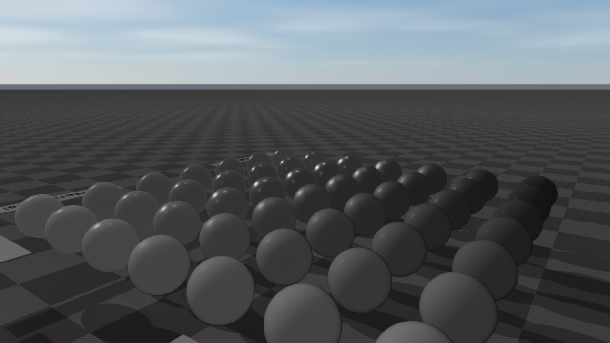

# Rayrai Example: PBR Material Grid

## Overview

Renders the Khronos MetalRoughSpheres glTF asset to check metallic-roughness material import, lighting, and shadow response in rayrai.

## Screenshot



*The MetalRoughSpheres model is licensed under CC BY 4.0 and credited in [Asset Credits](../../AssetCredits.md#metal-rough-spheres).*

## Target

CMake target: `rayrai_pbr_material_grid`.

## Run

Run the build-tree executable:

```bash
./build-examples/examples/rayrai_pbr_material_grid
```

On Windows, run `rayrai_pbr_material_grid.exe` instead.
This example renders in process with rayrai and does not need `rayrai_tcp_viewer`.

## Details

- Loads `rayrai/pbr/MetalRoughSpheres/glTF/MetalRoughSpheres.gltf`.
- Displays a grid of spheres spanning metallic and roughness values.
- Animates the mesh orientation so highlights and shadows can be checked over time.
