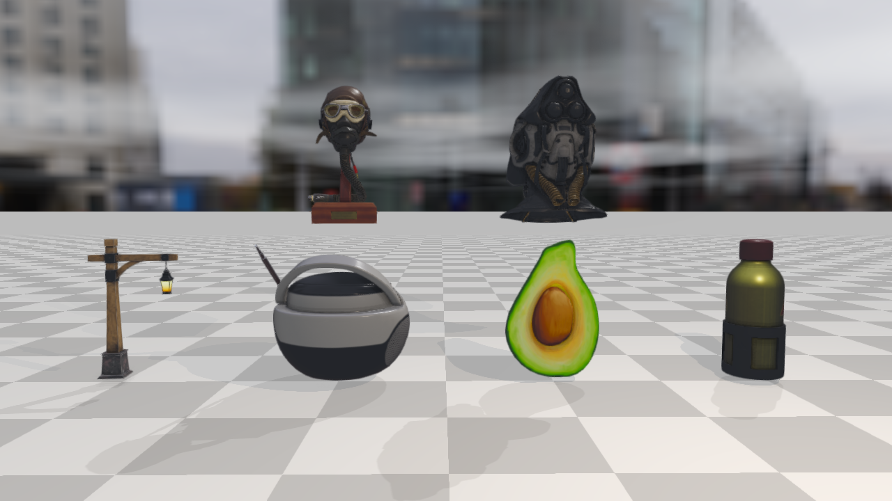

# Rayrai Example: PBR Texture Maps

## Overview

Loads six Khronos glTF Sample Assets in one interactive rayrai scene. The example is
an asset inspector for textured PBR import, HDR image-based lighting, normal maps,
metallic-roughness maps, occlusion maps, emissive maps, and mixed asset scales/units.

The six assets are CC0; each keeps its license file under `rsc/rayrai/pbr`.
The example leaves out `DamagedHelmet` and `AntiqueCamera` from the same
folder: the first is licensed for non-commercial use only (CC BY-NC 4.0) and
the second carries a UX3D trademark, so renders of them cannot be published
freely. Check an asset's license file before loading it into a scene you
share.

## Screenshot



## Target

CMake target: `rayrai_pbr_texture_maps`.

## Run

Run the build-tree executable:

```bash
./build-examples/examples/rayrai_pbr_texture_maps
```

On Windows, run `rayrai_pbr_texture_maps.exe` instead.
This example renders in process with rayrai and does not need `rayrai_tcp_viewer`.

Pass `--screenshot PATH` to render with a hidden window, wait until every
asset has loaded, save the final image as a PNG, and exit:

```bash
./build-examples/examples/rayrai_pbr_texture_maps --screenshot /tmp/pbr_texture_maps.png
```

## Details

- Loads these glTF assets from `rsc/rayrai/pbr`:
  `FlightHelmet`, `SciFiHelmet`, `Lantern`, `BoomBox`, `Avocado`, and
  `WaterBottle`.
- Applies a fixed per-asset scale so that each model's longest authored extent
  has about the same preview size, and lays the assets out in two rows, the
  helmets above the other four, that slowly turn about the vertical axis.
- Keeps assets upright in rayrai's and RaiSim's Z-up coordinate convention.
- Uses the Ultra quality preset with tuned exposure and shadows and one
  additional warm point light.
- Adds `rsc/rayrai/hdr/polyhaven/potsdamer_platz_1k.hdr` as an HDR
  environment. The HDR is used both for the visible background and for PBR
  reflections through environment, irradiance, prefiltered environment, and
  BRDF lookup textures.
- Lets the user orbit the camera to inspect the assets; this is the preferred
  example for checking whether imported PBR texture maps are actually active.
