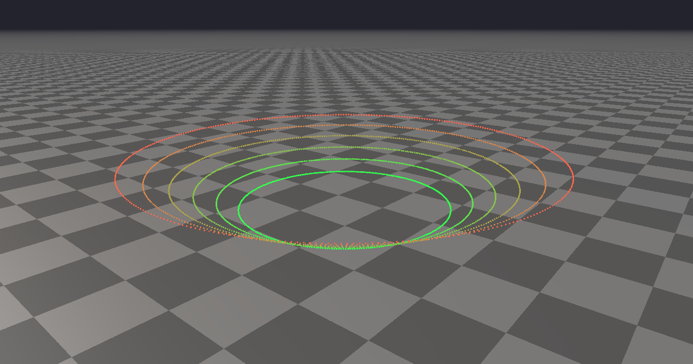

# Rayrai Example: Pointcloud Animation

## Overview

Generates animated ring point clouds to show per-point color updates and dynamic point buffer uploads.

## Screenshot



## Target

CMake target: `rayrai_pointcloud_animation`.

## Run

Run the build-tree executable:

```bash
./build-examples/examples/rayrai_pointcloud_animation
```

On Windows, run `rayrai_pointcloud_animation.exe` instead.
This example renders in process with rayrai and does not need `rayrai_tcp_viewer`.

## Details

- Builds a synthetic multi-ring point cloud with per-ring colors.
- Updates positions every frame to create an orbiting animation.
- Good for testing point-cloud upload and rendering.
