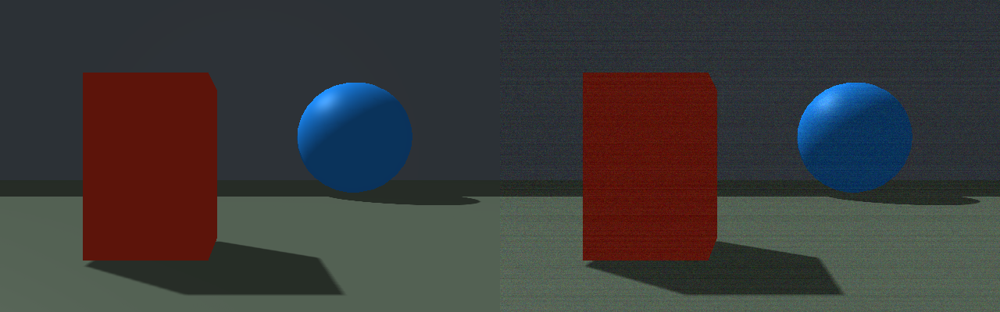
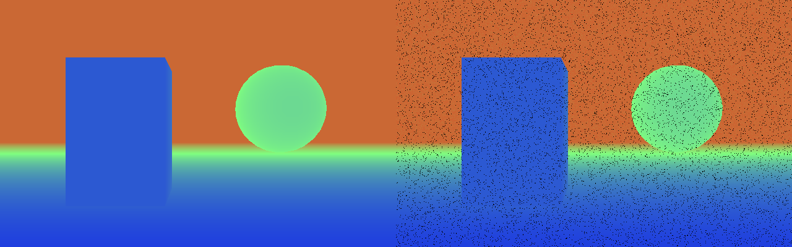

Rayrai sensor noise
===================

``rayrai_sensor_noise`` is an offscreen example that saves clean/noisy RGB and
depth captures of the same rendered scene. It needs a current RaiSim/Rayrai
build with the sensor-noise API, an OpenGL context, and no robot assets.

.. code-block:: bash

    ./rayrai_sensor_noise

The example takes no arguments and writes ``rgb_noise.png`` and ``depth_noise.png``
to its working directory. Run it in the directory where you want those images.
On Linux without a display, select SDL's offscreen video driver:

.. code-block:: bash

    SDL_VIDEODRIVER=offscreen ./rayrai_sensor_noise

The left panel is clean and the right is noisy. RGB combines read noise, the
high photon-count shot-noise approximation, and row offsets. Depth combines
distance-dependent noise, 2 cm quantization, and 4% dropout (black pixels).
The deliberately visible settings illustrate the effects; calibrate the
parameters for your device.

The source changes sensor properties between two readbacks of the same render
target. This isolates measurement noise from changes in scene state and avoids
a second scene render. ``getRawImage()`` applies noise automatically; manual
setters preserve input until ``applyNoise()`` is explicitly called.
See :ref:`sensor-noise-models` for model details and LiDAR configuration.

.. literalinclude:: ../../../../examples/src/rayrai/sensors/rayrai_sensor_noise.cpp
   :language: cpp
