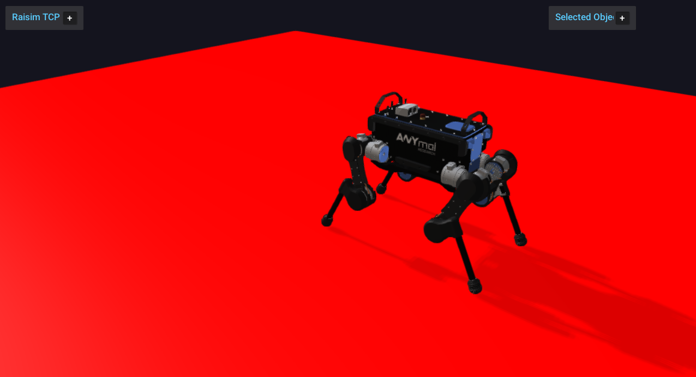

# Server Example: Kinematic Platform

## Overview

Creates a kinematic platform that moves up and down sinusoidally under an
ANYmal. It demonstrates kinematic bodies and their interaction with dynamic
robots.

## Screenshot



## Target

CMake target: `kinematic_platform`.

## Run

Run the build-tree executable:

```bash
./build-examples/examples/kinematic_platform
```

On Windows, run `kinematic_platform.exe` instead.
This example uses RaisimServer. Start `rayrai_tcp_viewer` and connect to port 8080.

## Details

- Creates a 10 m × 10 m kinematic box (infinite mass) as the ground and sets
  a sinusoidal vertical velocity on it every step.
- Places an ANYmal on top with PD posture control.
- Demonstrates `BodyType::KINEMATIC` and prescribed motion.
