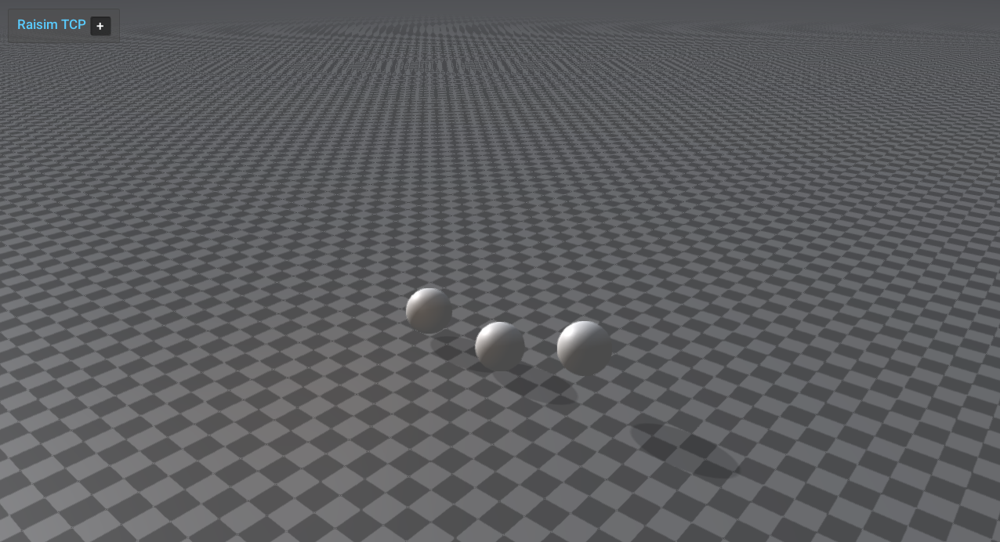

# Server Example: Material Restitution

## Overview

Drops spheres with different material labels (steel, rubber, copper) onto a
steel ground and configures the material pair properties. All pairs use the
same friction coefficient, so the spheres differ only in how much they bounce.

## Screenshot



## Target

CMake target: `material_restitution`.

## Run

Run the build-tree executable:

```bash
./build-examples/examples/material_restitution
```

On Windows, run `material_restitution.exe` instead.
This example uses RaisimServer. Start `rayrai_tcp_viewer` and connect to port 8080.

## Details

- Drops three spheres with different materials onto a steel ground.
- Sets the restitution of each pair with the ground (steel 0.95, copper 0.65,
  rubber 0.15) to compare bounce behavior.
- Reference for `World::setMaterialPairProp` restitution settings; see
  [Material System](../../MaterialSystem.md).
