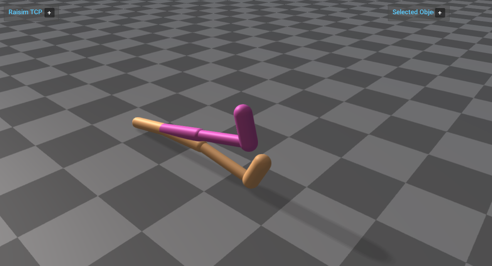

# Server Example: MJCF Gymnasium Walker2d



## Overview

Loads the Gymnasium Walker2d MuJoCo XML asset through `raisim::World` and
publishes it through `raisim::RaisimServer`. Its links touch the floor but
not each other, as in MuJoCo: their geoms have `conaffinity="0"` and the
floor `conaffinity="1"`.

## Target

CMake target: `mjcf_gymnasium_walker2d`.

## Run

Run the build-tree executable:

```bash
./build-examples/examples/mjcf_gymnasium_walker2d
```

On Windows, run `mjcf_gymnasium_walker2d.exe` instead.
This example uses RaisimServer. Start `rayrai_tcp_viewer` and connect to port 8080.

## Details

- Loads `rsc/mjcf/gymnasium/walker2d.xml` with the `raisim::World`
  constructor and retrieves the articulated system by its root body name
  (`torso`).
- Handles a multi-link MJCF articulated system with contact-enabled geoms.
- Applies a small sinusoidal torque pattern to the non-root joints in
  `FORCE_AND_TORQUE` control mode.
