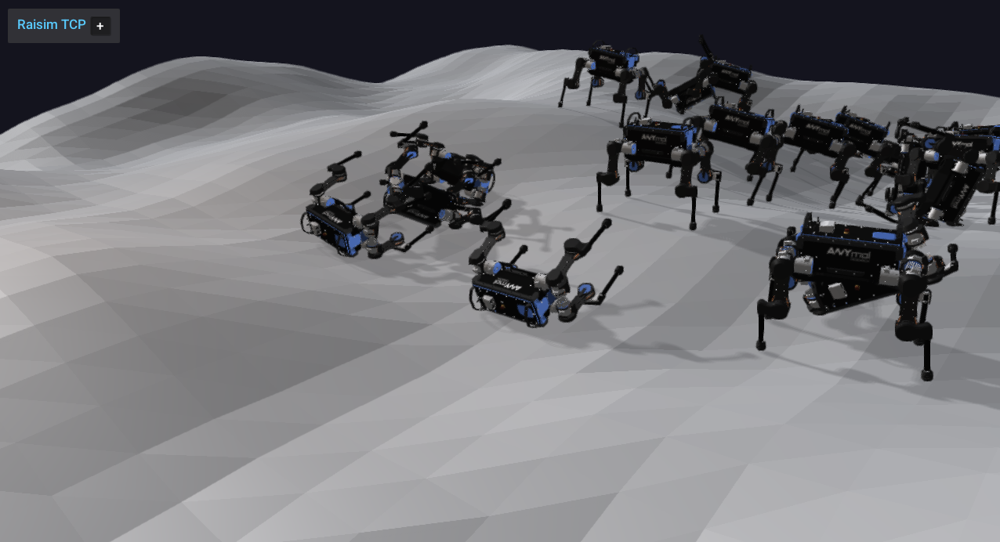

# Server Example: Procedural Heightmap

## Overview

Creates a procedural heightmap and drops a grid of ANYmal robots onto it. Use
it to see how to configure fractal terrain properties and run robots on
generated terrain.

## Screenshot



## Target

CMake target: `procedural_heightmap`.

## Run

Run the build-tree executable:

```bash
./build-examples/examples/procedural_heightmap
```

On Windows, run `procedural_heightmap.exe` instead.
This example uses RaisimServer. Start `rayrai_tcp_viewer` and connect to port 8080.

## Details

- Generates terrain from `TerrainProperties` (fractal noise).
- Spawns a 6 × 6 grid of ANYmal robots above the heightmap with joint PD
  gains.
- Demonstrates procedural heightmap creation and appearance; see
  [Height Map](../../HeightMap.md).
