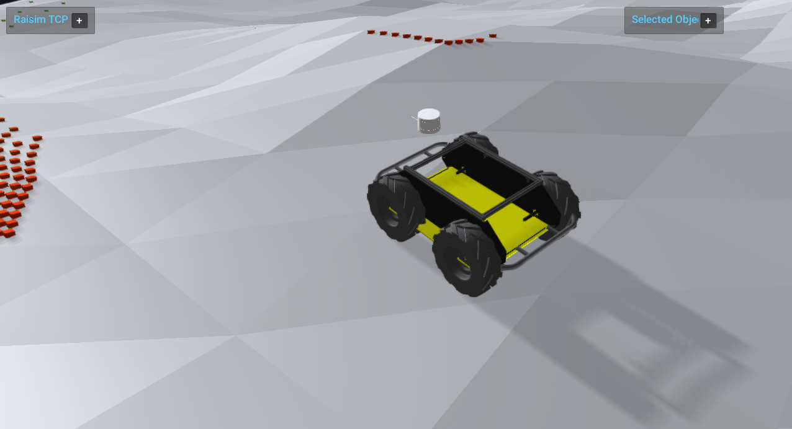

# Server Example: Ray Scan LiDAR

## Overview

Sweeps rays from a frame on a Husky robot to emulate a LiDAR scan and
visualizes the hits with instanced boxes. This is a compact example of
ray-based sensing; see [Ray Test](../../RayTest.md).

## Screenshot



## Target

CMake target: `ray_scan_lidar`.

## Run

Run the build-tree executable:

```bash
./build-examples/examples/ray_scan_lidar
```

On Windows, run `ray_scan_lidar.exe` instead.
This example uses RaisimServer. Start `rayrai_tcp_viewer` and connect to port 8080.

## Details

- Sweeps a yaw/pitch grid and uses `rayTest` to emulate LiDAR.
- Displays scan points as instanced boxes colored by range.
- Uses an IMU frame for ray orientation and resets the robot when out of bounds.
