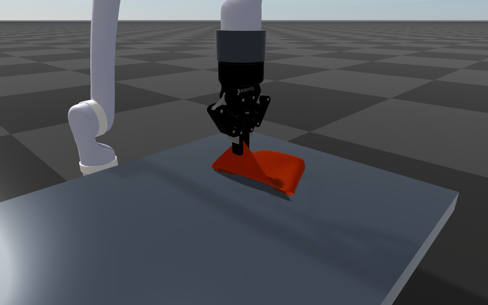

# Server Example: Robotiq Cloth Fold

## Overview

A fixed-base Kinova arm with a wrist-mounted Robotiq 2F-85 folds a square cloth
in half on a table. The pads hold one corner of the hanging cloth. The arm moves
across the cloth while lowering it, so the lower half lies down on the table,
then swings the held corner over onto the corner that touched down first. It
holds the fold, unfolds the cloth along the same path, lifts it back up,
restores the starting state, and repeats the 15-second cycle. All motion comes
from joint PD control and physical contacts.

The cloth is a deformable object in contact with the gripper pads, the table
and itself (see [Deformable Objects](../../DeformableObject.md)). It is solved
together with the arm, the pads and the table
([`World::setMonolithicDeformables()`](../../DeformableObject.md#solving-deformables-together-with-the-bodies)),
so the squeeze of the pads and the weight of the cloth act on the arm within the
same step. The arm and
gripper are the model of
[Server Example: Robotiq Gripper Mimic](./robotiq_gripper_mimic.md).



## Target

CMake target: `robotiq_cloth_fold`.

## Run

Run the build-tree executable and connect `rayrai_tcp_viewer` to port 8080:

```bash
./build-examples/examples/robotiq_cloth_fold
```

On Windows, run `build-examples/bin/robotiq_cloth_fold.exe` instead.
The example discovers its resource folder relative to the executable or
working directory. Normal RaiSim license discovery applies; use
`--activation-key /path/to/activation.raisim` for an explicit license.
`--port N` changes the server port. The example repeats until interrupted;
`--cycles N` stops it after N cycles. `--headless` runs two cycles without a
server and prints whether each one succeeded.

## Details

- Loads `rsc/robotiq_2f85/kinova_robotiq.urdf`. Only the six arm joints and
  `robotiq_85_left_knuckle_joint` have PD gains; the five gripper followers
  stay passive under their URDF `<mimic>` constraints.
- The cloth is a 0.2 m square of 19 x 19 particles weighing 20 g, with nearly
  inextensible edges, a bending modulus of 5e-5 N m, and self-collision, so the
  folded half rests on the lower half. Its elastic constraints are projected in
  10 sweeps of each 1 ms step. Its particles collide as 6 mm spheres,
  close enough that the 4 mm thick pads cannot slip between them.
- The pads clamp the corner face-on. The knuckle target lies beyond the
  closing angle at which the pads meet the cloth, so the knuckle PD squeezes it.
- Friction coefficients: 0.8 between the pads and the cloth, 0.6 between the
  table and the cloth, and 0.3 between two layers of cloth. The folded half
  slides into place over the lower half instead of dragging it along.
- The waypoints are positions of the gripper's `grasp_frame`, solved with
  `ArticulatedSystem::solveIK()` on a second, kinematics-only copy of the arm.
  The fold is planned when it begins: the cloth folds about the line half a
  diagonal from the corner that touched down, wherever that corner landed. The
  pads' lower edges circle that line at 8 cm, a little less than the cloth
  between them and the fold, because a taut upper half would pull the lower
  half across the table.
- A quintic time scaling covers each phase, and a cubic spline through the
  joint waypoints keeps the arm moving through them without stopping.
- Each cycle checks that both pads held the cloth throughout, that the lower
  corner rested on the table when the fold began, that the held corner then
  lay within 8 cm of the lower corner while the lower corner slid less than
  2 cm, and that the cloth hung clear of the table at the end.
- After each cycle the example restores a checkpoint of the settled initial
  world, including robot and cloth state and solver history.
- Controller updates run inside the RaisimServer world mutex and follow
  simulation time, so viewer pause and queued single-step pause the sequence.
- The combined arm and gripper model reuses the bundled BSD-licensed Kinova and
  Robotiq descriptions and meshes; see the license files in
  `rsc/robotiq_2f85` and `rsc/kinova`.
