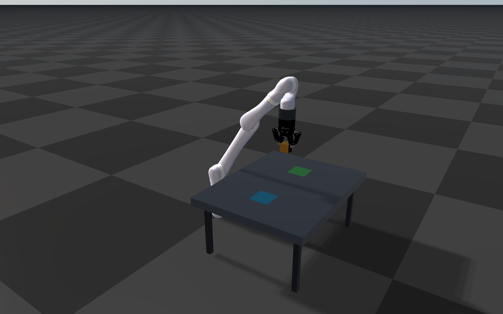

######################################
Server Example: Robotiq Gripper Mimic
######################################

Overview
========
A fixed-base, six-axis Kinova arm carries a wrist-mounted Robotiq 2F-85 through
predefined joint positions to pick up a cube at the blue marker and release it
at the green marker. The arm returns to its starting pose, resets the world,
and repeats the 21.5-second cycle. All motion during the task comes from joint
PD control and physical contacts.

The gripper is driven by its left knuckle. Its five other finger joints remain
passive and follow through URDF ``<mimic>`` constraints
(see :doc:`../../articulated_system/MimicJoints`).

Screenshot
==========

Target
======
CMake target: ``robotiq_gripper_mimic``.

Run
====
Run the build-tree executable and connect ``rayrai_tcp_viewer`` to port 8080:

.. code-block:: bash

   ./build-examples/examples/robotiq_gripper_mimic

On Windows, run ``build-examples/bin/robotiq_gripper_mimic.exe`` instead.
The example discovers its resource folder relative to the executable or
working directory. Normal RaiSim license discovery applies; use
``--activation-key /path/to/activation.raisim`` for an explicit license.
``--port N`` changes the server port. The example repeats until interrupted;
``--cycles N`` stops it after N cycles.

Details
=======
- Loads ``rsc/robotiq_2f85/kinova_robotiq.urdf``. The combined model reuses the
  bundled BSD-licensed Kinova arm and Robotiq descriptions and meshes. A fixed
  flange replaces the Kinova three-finger hand and the vertical ``lift`` joint
  of the standalone gripper model (``rsc/robotiq_2f85/robotiq_2f85_mimic.urdf``).
- Only the six arm joints and ``robotiq_85_left_knuckle_joint`` have PD gains.
  The five mimic followers have zero gains; the fingertips counter-rotate so
  the pads remain parallel.
- The cube is 40 mm on each side and weighs 100 g. It moves 360 mm between
  the table markers and rises about 200 mm during transfer.
- Four predefined arm configurations specify pickup, pickup hover, destination
  hover, and placement. A quintic interpolation supplies continuous position
  and velocity targets with zero velocity and acceleration at phase boundaries.
  Changing the model or marker positions requires updating these configurations.
- The closing target goes past the cube width, so the knuckle PD squeezes the
  cube. Pad friction supports the cube throughout lifting and transfer.
- After release, retraction, and return, the example restores a checkpoint of
  the settled initial world, including robot/cube state and solver history.
  The cube is repositioned only by this explicit reset at the cycle boundary.
- Controller updates run inside the RaisimServer world mutex and follow
  simulation time, so viewer pause and queued single-step pause the sequence.
