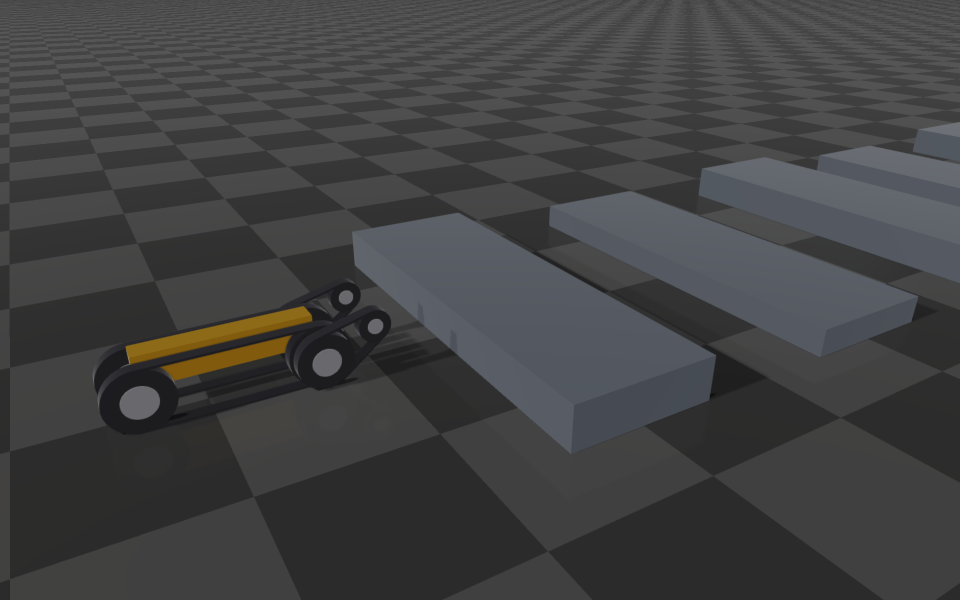

#######################################
Server Example: Templated Tracked Robot
#######################################

Overview
========
Loads a templated tracked robot URDF with parameter overrides and drives it over a row of steps. Its
four belts are URDF ``<track>`` elements (see :doc:`../../articulated_system/Tracks`), so the
controller only sets PD targets on the two sprockets and the two flippers. It also shows how to
customize URDF parameters programmatically.

Screenshot
==========

Target
======
CMake target: ``templated_tracked_robot``.

Run
====
Run the build-tree executable:

.. code-block:: bash

   ./build-examples/examples/templated_tracked_robot

On Windows, run ``templated_tracked_robot.exe`` instead.
This example uses RaisimServer. Start ``rayrai_tcp_viewer`` and connect to port 8080.

Details
=======
- Instantiates a templated tracked robot URDF with parameter overrides
  (``rsc/templatedTrackedRobot/trackedTemplate.urdf``).
- The main tracks wrap a sprocket and an idler; each flipper's track is driven from the sprocket's
  shaft, so it moves at the main belt's speed relative to the ground.
- Drives the sprockets at 5 rad/s (velocity control, 0.89 m/s belt speed) and holds the flippers
  raised at 0.6 rad (position control); the robot climbs the steps with its flippers.
- Adds a sequence of box obstacles in front of the robot.

